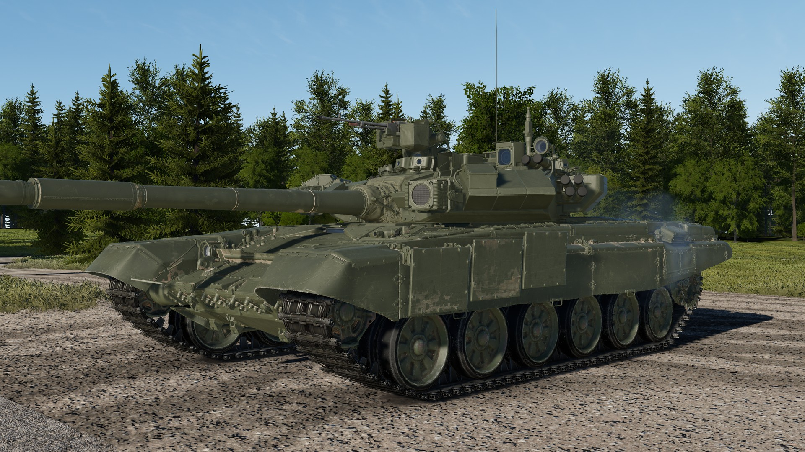
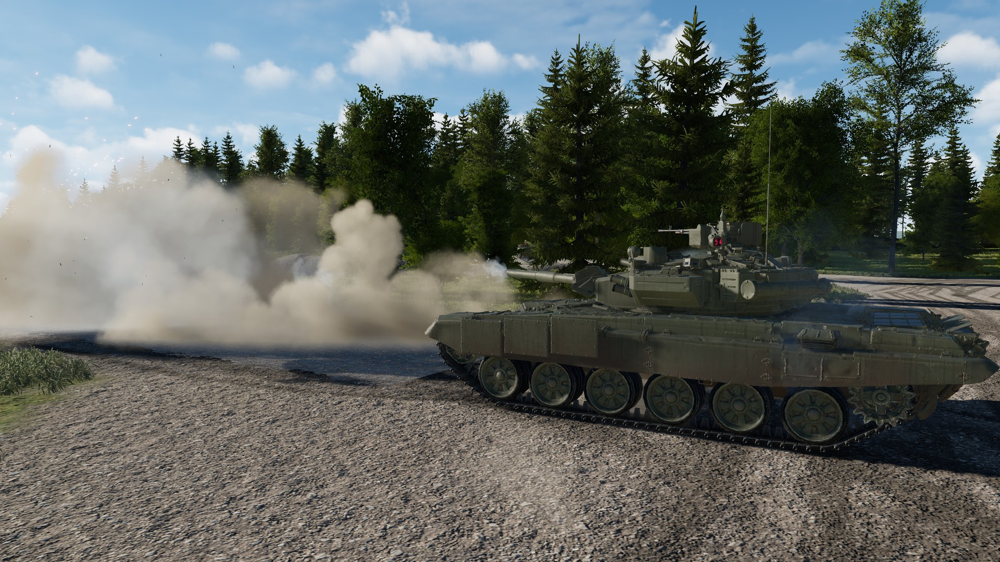
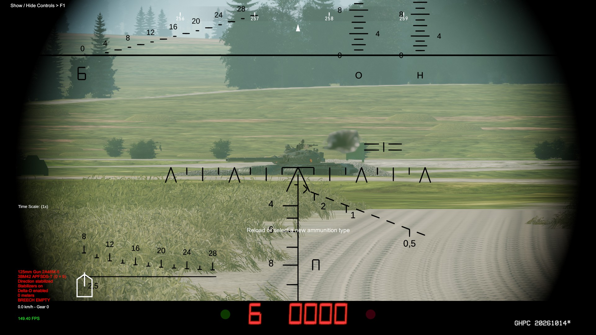
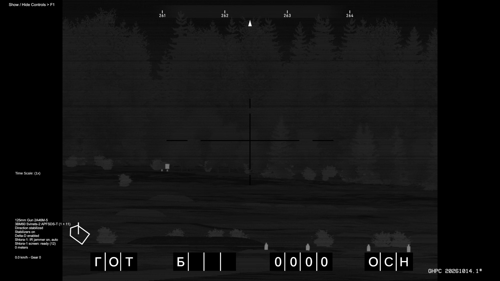
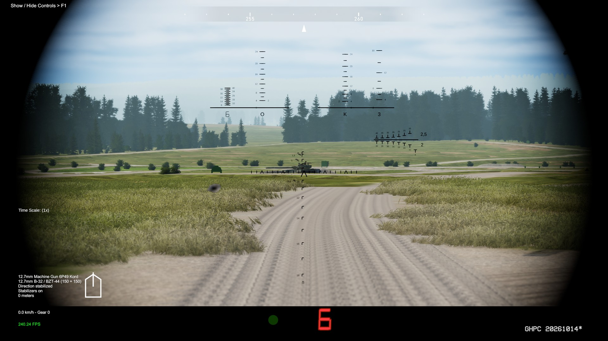
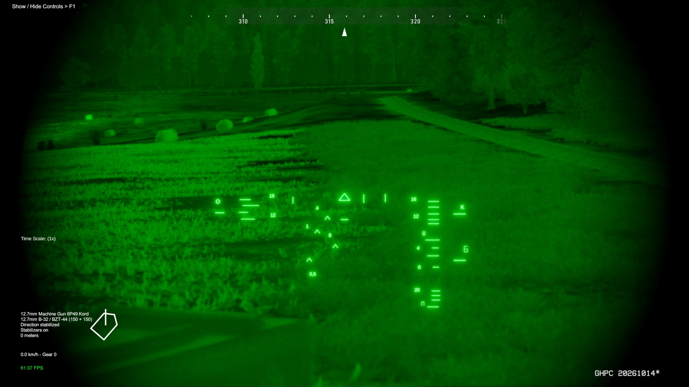
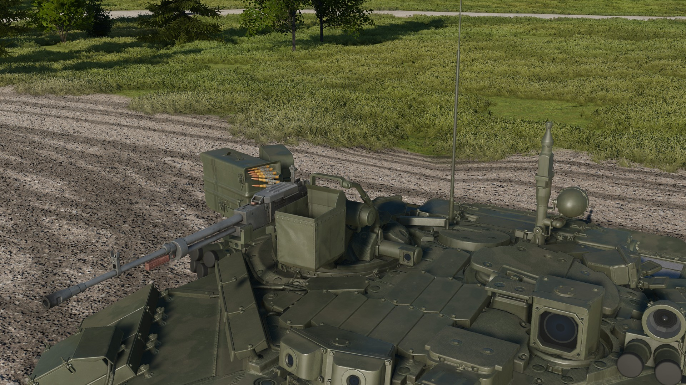
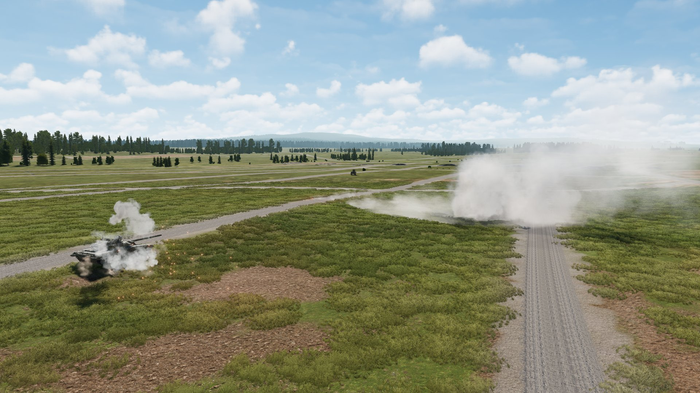
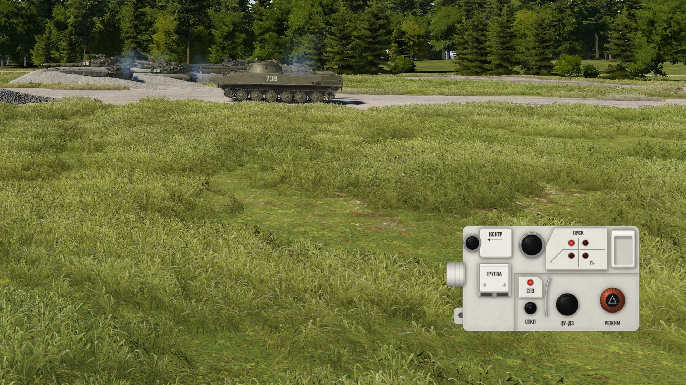
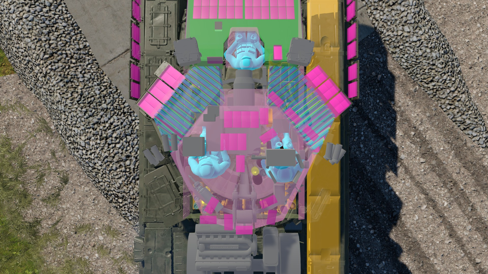

# T-90A for Gunner, HEAT, PC!

A Russian **T-90A** for GHPC, as its own unit. Welded turret, Kontakt-5, the 1G46 sight with the ESSA thermal,
Shtora-1, a remote Kord on the commander's cupola and the Invar missile through the gun.

I made this mod for myself first, but you're welcome to use it too. It's still being worked on, so a few things can
change between versions. It's a separate mod from my [T-90M](https://github.com/marsattackk/GHPC-T90M),
[T-80UM2](https://github.com/marsattackk/GHPC-T80UM2) and [Leclerc SXXI](https://github.com/marsattackk/GHPC-LeclercSXXI),
and they all work fine installed together.

<p align="center">
  
  
</p>

## Installing it

1. Get [MelonLoader](https://github.com/LavaGang/MelonLoader/releases) (0.7.3 or newer) into GHPC if you don't have it
   already. No other mod is needed.
2. Download `T90A_<version>.zip` from [Releases](../../releases/latest).
3. Copy the `Mods` folder from the zip into the game's `Bin` folder, the one with `GHPC.exe` in it (Steam: right-click GHPC >
   Manage > Browse local files, then open `Bin`). `MelonLoader` and `UserData` are in there too. You should end up with:
   ```
   Mods\T90A.dll
   Mods\T90A\t90a
   ```
4. Start the game. The T-90A is in **Instant Action** (unit "T-90A"), in the **Soviet campaign** roster, and in the
   "Showcase of most playable vehicles" mission.

To remove it, delete `Mods\T90A.dll` and the `Mods\T90A` folder. That's safe mid-campaign too, because the campaign
save doesn't keep a list of units.

Once per game start the mod asks GitHub whether there's a newer release. If there is, you get one line with a link in
the MelonLoader console and that's it: nothing in game, nothing downloaded. `Check for updates` turns it off.

## Overview

The T-90A (Object 188A1) is what the T-72B turned into. Uralvagonzavod gave the T-72B the T-80U's fire control and
Shtora-1, then a welded turret and a 1000 hp diesel, and it was accepted in 2005. From 2006 they came with the ESSA
thermal, and about 337 of those were built up to 2010.

In GHPC it's built on the game's T-72M1, so the hull, the running gear and the 22 rounds in the carousel under the crew
will all be familiar. Above that it's a different tank. It's far better protected from the front, it can see at night,
it has a missile that outranges any tank round, and Shtora-1 spoils the missiles and lasers aimed at it. From the side
and above it's still a T-72, and it dies like one.

If you've played the T-80B, most of the gunnery will feel familiar, because the 1A45T is the same school as the 1A33.
The full comparison with the T-72M1 and a bit more history are in [docs/details.md](docs/details.md).

## Target alerts

The crew are the T-80B's, Russian voices and all, and they call targets on the hull azimuth compass. "At 30" is dead
ahead of the hull, 15 is straight left and 45 straight right. The official
[T-80B gunnery guide](https://gunnerheatpc.com/news/articles/gunnery-guide-t-80b) explains the system properly.

## 1A45T fire control with the 1G46 sight

<p align="center">
  
  
</p>

The gunner's day sight is the 1G46, with the 1A45T fire control behind it:

- laser rangefinder, 400 to 5000 m
- automatic superelevation and lead
- delta-D
- 2.7-12x zoom
- a sight stabilised in both planes on its own, independent of the gun
- cant correction
- manual mode as a backup
- a fire gate that waits for the gun to be laid

Because the sight is stabilised on its own, it can look up to 8° to the side of the gun and from -15° to +20° up and
down. You aim the sight and the turret catches up.

**Automatic and manual modes.** These work as on the T-80B. Lasing (default E) puts the fire control in automatic mode,
with superelevation and lead on and the reticle centred. Setting the range by hand (default LCtrl + mouse wheel, or
PgUp / PgDn) drops it into manual. Lead and superelevation switch off and the range scales slide instead, with the HUD
showing the range for the loaded round. Most of the time you want automatic. Manual is for a dead rangefinder.

**Rangefinding.** The laser measures to the tip of the chevron and the range goes straight into the four digits at the
bottom of the sight. Under 400 m it won't take a reading. With the laser gone there's a stadiametric scale on the left
for a target 2.5 m tall, marked from 800 to 2800 m.

The coax PKT gets no help from the computer. Its scale is the vertical line under the chevron, out to 1400 m. Range the
target, note the number, reset the range, then aim with that scale.

**Lead.** In automatic mode the computer takes the last second of your traverse and works the lead out from it. So keep
the tip of the chevron on the target, matching its speed, for a full second before you fire, whether it's moving or
not. If the reticle isn't glued to the target, the round goes wide. Lead is sideways only, as on the T-80B.

**Firing when laid.** After a lase the gun won't fire until it has actually climbed to the elevation the computer set,
which is what the real firing-permission circuit does. On a long shot you'll feel it as a short pause. With
`Fire only when the gun is laid` off it fires whenever you like, but a shot while the gun's still climbing falls short.

**The strip under the picture.** Four range digits in the middle, and on their left the round in seven segments: Б for
APFSDS, К for HEAT, О for HE and У for the missile, or as near as seven segments get. The green lamp on the left means
loaded and laid. The red one on the right means the commander has the turret (default Spacebar).

## Night fighting

The ESSA thermal (default T) shows the picture the way the real gunner gets it: a camera feeding a small 4:3 CRT
monitor, with scan lines, black bars either side and faint streaks drifting across. The wide field (9 × 6.75°) is for
looking and the narrow one (3 × 2.25°) for shooting, with a x2 electronic zoom on top. The fire control works through it
the same as through the day sight. The narrow field has a thin cross and four boxes under it: ready, round, range and
mode. The wide field has no cross, so don't shoot from it.

Like any thermal it sees through smoke and the laser doesn't. A range taken into a cloud is the cloud's, so check the
day sight before you trust it.

The first 32 T-90As had the Buran-M image intensifier instead, and `Gunner night sight` gives you that. The T-80B's
TPN-3-49 stands in for it, sliding range scales and all, so set the range by hand the way the T-80B guide says.

## The commander's TKN-4S and the Kord

<p align="center">
  
  
</p>

The commander has the TKN-4S "Agat-S", a day and night sight with its reticles drawn from a photo of the real one. It's
also what aims the remote 12.7 mm Kord on the cupola. Select the Kord and you're straight in the TKN-4S, in "Avtomat"
mode: stabilised, the Kord following the sight, and the range keys setting the superelevation against its ballistic
scale. "Cycle View" swaps to the simpler PZU-7 and back. You can't fire it from the free-look head view.



The hatch stays shut the whole time. Two belts of 150 at 625 rounds a minute, three armour-piercing incendiary to one
tracer, and the spent cases pile up on the roof until you brake hard. AI T-90As leave it alone.

## Shtora-1

<p align="center">
  
  
</p>

It doesn't shoot anything down. It messes with how the other guy aims, and using it well is mostly about where your gun
points.

- The two red lamps either side of the gun are an IR jammer. A TOW, HOT, MILAN, Fagot, Konkurs, Kobra, Falanga or
  Shturm coming in within 20° of where your gun points goes wide about 6 times in 10, wire or radio link alike. Point
  the gun at the launcher. Each lamp can be shot off.
- Get lased and the commander's panel pops up bottom right with a tone and a lamp for the direction. The lamps go by
  the turret, not the hull.
- Lased from in front of the turret, it fires a 3D17 grenade between you and the shooter by itself. The cloud builds in
  about 3 s and stands for about 20, and anyone lasing through it has to judge the range by eye.

From the side or rear you only get the warning. **Turn to Laser** in the vehicle menu swings the turret round until a
front head sees the laser, and if they're still lasing you the screen goes up from there. It won't fire with a hatch
open or for 15 s after your own main gun shot. In SEMI mode you fire the screen yourself with the smoke key (default G)
or from the vehicle menu.

Lase an AI T-90A from the front and it screens itself. Lase it from the side and the turret comes round at you. How
each part works is in [docs/screens.md](docs/screens.md).

## Armour protection



From the front, above the ring, it's strong. Each cheek of the welded turret holds 19 packages of reflecting plates, and
with Kontakt-5 on top the cheeks and the upper glacis stop 3BM42, all three HEAT rounds and the Invar. Once the glacis
ERA has gone, the bare plate still stops 3BK18M, 3BK29M and the Invar, but a 3BM42 or a 3BK31 gets through. A brick
only goes off for something worth it, so a PKT burst won't strip it the way it would in
vanilla GHPC.

Straight from the front, in mm of steel, without ERA:

| | Turret cheeks (vs APFSDS / vs HEAT) | Upper glacis (vs APFSDS / vs HEAT) |
|---|---|---|
| **T-90A** | **690 / 819** | **549 / 748** |
| T-80B (vanilla) | 595 / 669 | 485 / 602 |
| M1IP (vanilla) | 516 / 999 | 348 / 361 |

Kontakt-5 adds about 140 vs APFSDS and 550 vs HEAT on top.

The weak spots are the ones every T-72 descendant has. The lower front plate is about 200 mm and anything goes
through. The mantlet and its joins with the cheeks let a 3BM42 in on the right side of the gun. The strip of turret
ring above the glacis is about 290 mm. The sight heads on the roof are thin too, but a hit there costs you the sight
rather than the crew.

From the side the hull stops nothing a tank fires, and on the left that's straight into the carousel. Hull-down and
nose on, it's a hard tank to kill. Side on, it's a T-72.

Where the numbers come from, my test firing and every weak spot: [docs/armour.md](docs/armour.md).

## Ammunition

42 rounds: 22 APFSDS, 8 HEAT, 8 HE-Frag and 4 Invar. 22 sit in the carousel, two of them missiles, and the rest are
spares round the crew in the T-72B manual's places. The autoloader runs at the game's own T-72M1 speed, about 7.2 s a round.

| Round | Penetration |
|---|---|
| 3BM42 "Mango" | ~580 mm at the muzzle, ~460 mm at 2 km |
| 3BM60 "Svinets-2" | ~690 mm at the muzzle, ~600 mm at 2 km |
| 3BK29M HEAT (default) | 700 mm, tandem, 915 m/s |
| 3BK31 "Start-2" HEAT | 800 mm, a precursor and two main charges |
| 3BK18M HEAT | 585 mm, the game's own round |
| 3OF26 HE-Frag | the game's own round |

3BM60 is the default and 3BM42 the alternative, picked in the game's normal ammo menu. In the campaign 3BM60 only turns
up after four missions and runs short when Pact logistics go badly, and 3BM42 fills the gap.

**The HEAT.** It's the same three rounds as on my T-90M, picked in the same menu, and both dropdowns have a Random
entry. 3BK29M has a small charge in the nose that sets off add-on ERA like Kontakt-1 before the main charge gets there,
and it comes out about 50 mm down. It can't do that to built-in ERA (Kontakt-5, Relikt), so against those it's a single
charge again. 3BK31 was only ever an experimental round, shown at Omsk in 1997. It gets through either kind of ERA with
660-680 mm left, and its two main charges go in as two jets, which you can see in the recap. The campaign never hands
out 3BK31. Set `Force HEAT` if you want it there.

**The Invar.** The 9M119M rides a laser beam from the 1G46, so it goes where the chevron is. Keep the tip on the target
until it hits. It arms at 100 m and takes about 17.6 s to reach 5000 m, and its tandem warhead (700 mm) sets the ERA off
before the main charge. That's further than any tank round in the game, but it's also a long time to sit still, so
pick your moment.

Keep the nose towards trouble and the gun towards whoever's got a missile, and it'll look after you.

## Settings

After the first start, `UserData\MelonPreferences.cfg` in the game folder has a `[T-90A]` section. You can edit it
with the game running: MelonLoader reloads the file when you save it.

| Setting | Values | Default |
|---|---|---|
| `Enabled` | true / false | true |
| `Add to campaign roster` | true / false | true |
| `Campaign prevalence` | how common it is (1 = as common as a typical tank) | 0.5 |
| `Campaign unlock after missions` | number | 2 |
| `APFSDS` | `"3BM42"` / `"3BM60"`, where the game doesn't pick one itself | 3BM60 |
| `Force APFSDS` | true: the campaign gives every T-90A the `APFSDS` round instead of drawing one from its ammo supply | false |
| `Random APFSDS` | true: each T-90A rolls its own APFSDS from `APFSDS pool` in Instant Action and scripted missions, and the mission customizer's ammo dropdown starts on Random; the campaign keeps its own ammo supply | false |
| `APFSDS pool` | the rounds `Random APFSDS` rolls from, as name:weight (`"3BM42:3, 3BM60:1"`); empty: every APFSDS at its campaign weight | `""` |
| `HEAT` | `"3BK29M"` / `"3BK31"` / `"3BK18M"`, where the game doesn't pick one itself | 3BK29M |
| `Force HEAT` | true: the campaign gives every T-90A the `HEAT` round instead of drawing 3BK29M or 3BK18M from its ammo supply | false |
| `Random HEAT` | true: each T-90A rolls its own HEAT from `HEAT pool` in Instant Action and scripted missions, and the mission customizer's HEAT dropdown starts on Random; the campaign keeps its own ammo supply | false |
| `HEAT pool` | the rounds `Random HEAT` rolls from, as name:weight (`"3BK29M:3, 3BK18M:1"`); empty: 3BK29M and 3BK18M at their campaign weights, 3BK31 only if you name it | `""` |
| `Ammunition load` | `"Full"` / `"Autoloader"` (only the 22 rounds of the autoloader, 2 of them missiles), on every T-90A, friend and foe | Full |
| `Empty racks` | racks to leave empty, comma separated (`"hull"`); replaces `Ammunition load`; the autoloader is always loaded | `""` |
| `Gunner night sight` | `"ESSA"` / `"Buran-M"` | ESSA |
| `ESSA electronic zoom` | true / false | true |
| `Fire only when the gun is laid` | true: after a lase the gun waits until it's at the elevation the computer set. false: fires any time, but a shot while it's still climbing falls short | true |
| `Weathered paint` | true / false (clean factory paint) | true |
| `Shtora-1` | false gives you the game's ordinary smoke salvo instead | true |
| `Shtora-1 automatic screens` | false: the warning only, and you fire the screen from the vehicle menu or with the smoke key | true |
| `Shtora-1 alarm tone` | false: the panel's lamps only | true |
| `Shtora-1 jammer on at spawn` | false: off until you switch it on (AI crews still do in a fight) | true |
| `Shtora-1 jam chance` | 0 to 1, how often the jammer throws off a missile guided from its launcher (wire or radio) fired from in front of the gun | 0.6 |
| `Shtora-1 panel on screen` | false: no panel, the tone only | true |
| `Shtora-1 panel always on screen` | true: on screen the whole time you're in the T-90A | false |
| `Kord spent cases` | false: no cases, the belt still feeds | true |
| `ERA destruction effects` | true: a brick that's gone off blows open, charred inside, lid thrown off, nets cut | false |
| `Armour preset` | `"game-scale"` / `"source-only"` (the lower open-source figures) | game-scale |
| `Check for updates` | true / false | true |

Leave the `ConfigVersion` line at the end alone. It's how the mod tells which settings are still on an old default.
Most settings apply to T-90As spawned after you save, the three campaign ones at the next mission load. `Enabled`
needs a restart. A number saved with a decimal comma (`"0,3"`) is read fine too, but only when the game starts.

## Bugs and suggestions

I'm open to suggestions, fixes, better sources, pull requests, whatever you've got. If you know something about the real
T-90A that the mod gets wrong, tell me.

Found a bug? Open an [issue](../../issues) and attach `MelonLoader\Latest.log` from the game folder. The mod writes a
warning there whenever something didn't load right or a game update has broken one of its hooks.

I only make and test it on the current Steam version of GHPC. A cracked copy or an old build might not load it at all
and I can't help with those, so make sure you're up to date before opening an issue.

## Maintaining it

The whole source is here so anyone can keep the mod working after a GHPC update without waiting for me. Pull requests
are welcome, and under the GPL a fork is fine too.

`T90A\` is the tank itself and `Common\` is the machinery it's built with, shared with my other ports. `Resources\`
holds the data built into the DLL: reticles, armour values, hatches, smoke points and the rest. The asset bundle
(`Mods\T90A\t90a`: model, textures, armour meshes) isn't built from this repo and neither is the Unity project behind
it, so take it from a release. The code here needs the bundle from 0.5.0 or later, because the 0.4.4 one still has
the old armour pieces.

To build it you need the .NET SDK 6 or newer and GHPC with MelonLoader, because the build references the game's DLLs:

```
dotnet build -c Release -p:GameDir="<GHPC folder>\Bin"
```

The DLL lands in `bin\Release\T90A.dll`.

When a game update breaks something, start with this:

```
powershell -ExecutionPolicy Bypass -File tools\check-game.ps1 -GameDir "<GHPC folder>\Bin"
```

It looks up every hook the mod has in the new game's DLLs without starting the game and lists what's gone. A broken
hook only takes its own feature down, and `MelonLoader\Latest.log` names it. [docs/game-updates.md](docs/game-updates.md)
goes through the rest of the repair and what to test after it.

`dotnet test tests` runs everything that doesn't need the game (the reticles, the armour data, the settings), and GitHub
runs it on every push. `tools\check-settings.ps1` makes sure the settings table above still matches the code, so a new
setting needs a row there.

For the rest, [MAINTAINING.md](MAINTAINING.md) covers the layout, what happens when a T-90A spawns, the settings and
releasing, and [docs/bundle.md](docs/bundle.md) says what the code expects to find in the bundle.

This README follows `main`, which can be ahead of the latest release.

## Where the model comes from, and the licence

The 3D model and textures are War Thunder's T-90A, taken from War Thunder's game files. They belong to Gaijin
Entertainment and they're not covered by this repository's licence. The same goes for the armour shapes, cut from War
Thunder's damage model. Everything else (the armour values, the sights and their reticles, the fire control, the ammo,
the interior) was built for GHPC from Russian sources.

A few files in `Resources\` are GHPC's own assets, reworked: the T-72M1 hull skin with its side skirts cut out
(`T72M1_skin_hull_trimmed.bin`), and the round meshes and stencil textures (`round_mesh_*.mesh`, `round_*_co.png`),
reshaped and repainted from the game's own rounds. Those belong to Radian Simulations, and the
licence doesn't cover them either.

The source code is under the [GNU General Public License v3.0](LICENSE).
