# T-90A for Gunner, HEAT, PC!

A Russian **T-90A** you can actually drive and fight in GHPC, as its own unit. Welded turret, Kontakt-5, 1G46 sight,
ESSA thermal, the remote Kord on the commander's cupola, 3BM42 / 3BM60 and the Invar missile.

I made this mod for myself first, but you're welcome to use it too.

<p align="center">
  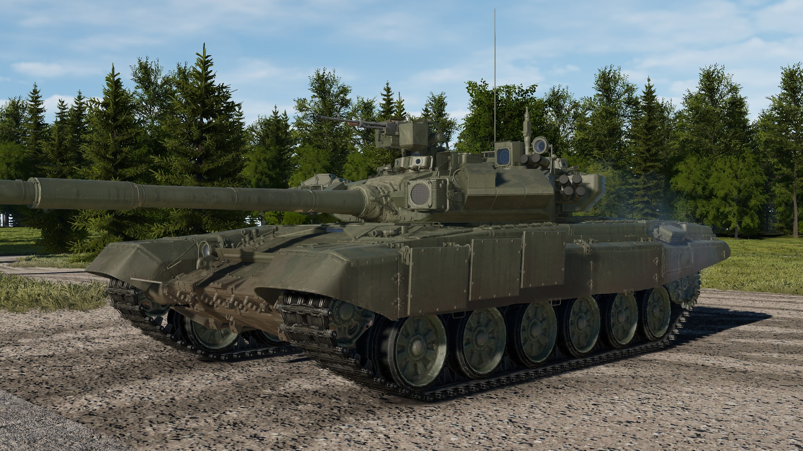
  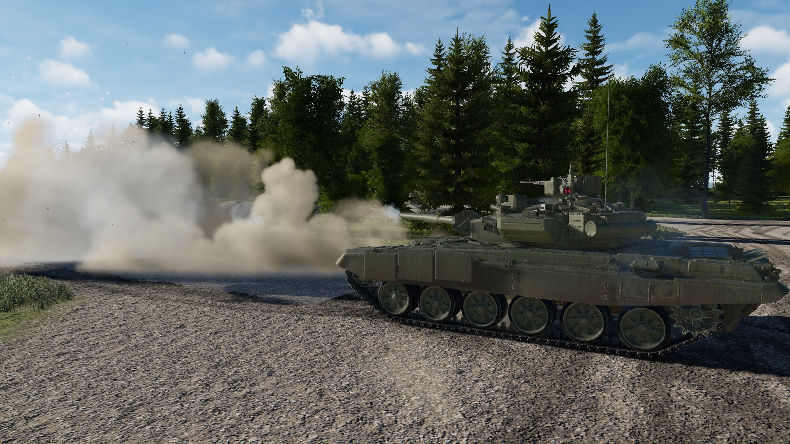
</p>

This README describes **version 0.3.0**. No other mod needed, just MelonLoader.

## Installing it

1. Get [MelonLoader](https://github.com/LavaGang/MelonLoader/releases) (0.7.3 or newer) into GHPC if you don't have it already.
2. Download `T90A_<version>.zip` from [Releases](../../releases/latest).
3. Copy the `Mods` folder from the zip into the game folder, the one with `GHPC.exe` in it (Steam: right-click GHPC >
   Manage > Browse local files). You should end up with:
   ```
   Mods\T90A.dll
   Mods\T90A\t90a
   ```
4. Start the game. The T-90A is in **Instant Action** (unit "T-90A"), in the **Soviet
   campaign** roster, and in the "Showcase of most playable vehicles" mission.

To remove it, delete `Mods\T90A.dll` and the `Mods\T90A` folder.

## "It's a War Thunder model, does it even work in GHPC?"

Fair question, and the short answer is yes. Only the **looks** come from War Thunder. Everything that decides what
happens when a round hits was built for GHPC, using GHPC's own rules:

- **The armour is GHPC armour.** It's made of the same kind of armour pieces the vanilla tanks use, laid plate by plate
  onto the T-90A's own hull and turret faces. No War Thunder armour value is used anywhere: War Thunder was only a
  checklist of what parts exist.
- **No holes.** The turret is covered from every direction (front, sides, rear, roof, also with the turret turned). The
  hull is the T-72's (which the T-90's really is), with its armour fitted onto the T-90A's plates; the few gaps it has
  are the same ones the vanilla T-72M1 has.
- **The inside works like a vanilla tank.** Crew, ammo and the autoloader carousel are placed in the T-90A's own
  interior layout. The crew compartments are built the way GHPC expects (a round has to get through the armour before it counts
  as "inside"). Engine, transmission, gun and turret drives, the sights, fire control computer, radio and so on are real
  damageable modules wired into the game's own systems, so knocking out a drive or a sight does what it does on any
  vanilla tank.
- **Tested with real rounds.** I shot it in game, hundreds of rounds at spots all over the tank, next to a vanilla
  T-72M1 getting the same treatment, and checked where every round stopped. The hit x-ray shows every armour layer with its own colour and name.
- **The AI handles it like a vanilla tank.** AI crews pick ammo and shoot at the same pace as with the T-72M1 or T-80B,
  it burns and cooks off like the T-72M1 next to it, and the running gear, tracks and hatches keep up when it drives.
- **It fits in visually.** Glass and lenses use the game's own glass, the paint has the same finish as the vanilla
  tanks, and the smoke tube caps pop off when a salvo fires, like on the vanilla tanks. At range it switches to a
  lighter model, so it doesn't cost more to draw than a vanilla tank.

<p align="center">
  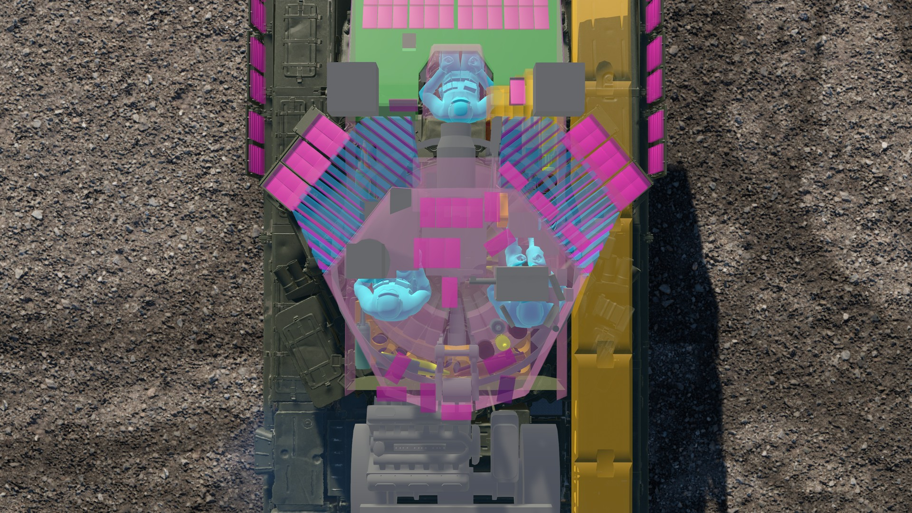
  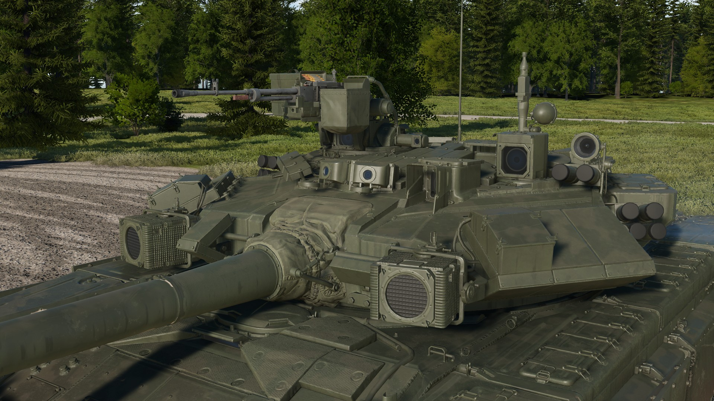
</p>

*Left: the game's hit x-ray from above: the plate packages standing in both cheeks, the crew (light blue) and the ammo.
Right: the sight windows and Shtora lenses on the game's own glass, and the black caps on the smoke tubes.*

## The armour, in numbers

Here's how it stacks up against GHPC's own tanks. Line-of-sight protection straight from the front, in mm of steel,
**without ERA**:

| | Turret cheeks (vs APFSDS / vs HEAT) | Upper glacis (vs APFSDS / vs HEAT) |
|---|---|---|
| **T-90A (this mod)** | **693 / 822** | **549 / 749** |
| T-80B (vanilla) | 595 / 669 | 485 / 602 |
| M1IP (vanilla) | 516 / 999 | 348 / 361 |

Kontakt-5 adds about **140 / 550** on top wherever a block is hit (a block that's gone off is gone: a second hit on the
same spot only meets the armour behind it).

*How these were measured: median over a grid of straight-on shots, ERA left out. The T-90A was measured in game on its
cheek block and glacis. The vanilla tanks were worked out from their armour as it is in the game's own files, over the
whole cheek face, so their thin edges pull their median down a little.*

And what that means with actual rounds, fired in game straight at the front (ERA on, turret straight and turned 17°):

| | T-90A | vanilla T-72M1 |
|---|---|---|
| 3BM42 at the upper glacis | stopped inside the glacis | goes through |
| 3BM42 at the turret cheek | stopped by the cheek | stopped by the turret |
| 3BK18M HEAT at the turret cheek | stopped in the cheek packages | stopped by the turret |
| 9M119M Invar at the turret cheek | stopped by the cheek | depends on where it lands |

### Where the armour design comes from

The armour design is based on **real Russian documents I found online**, not on how it looked in War Thunder:

- **Turret cheeks:** the T-90A's welded turret has 19 packages of "reflecting plates" in each cheek (a 50 mm SK-2Sh
  plate, 6 mm of rubber and two 4 mm plates each), standing on edge across the cavity, between a 65 mm outer wall and a
  150 mm inner wall. From andrei_bt's research on T-72 / T-90 filler packages, btvt.info, and the UKBTM welded-turret
  patent RU 2112914.
- **Upper glacis:** the T-72B obr. 1989 / T-90 stack, layer by layer: 60 mm steel, rubber, steel plates with an air gap,
  60 mm steel, polypropylene, 50 mm steel. From Russian Wikipedia's «Т-90» article, the "Одетые в броню" forum and
  andrei_bt.
- **How strong it is overall:** Russian estimates for the T-90 turret (about 800-830 mm vs APFSDS with Kontakt-5) with
  the ERA taken off, plus the 10-15 % btvt gives the T-90A's welded steel over the cast turret. Kontakt-5 from the maker
  (NII Stali) and btvt.
- **Where nothing could be found** (bustle floor, turret bottom plate, a few small things), it's said so, and the value
  comes from the closest real equivalent or from the model's own shape.

There's also a "source-only" armour setting if you'd rather have the lower open-source figures (575 / 750 on the cheeks)
instead of the default.

## The sights

<p align="center">
  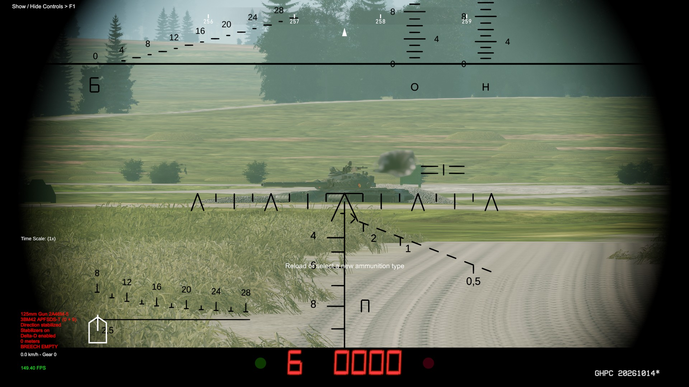
  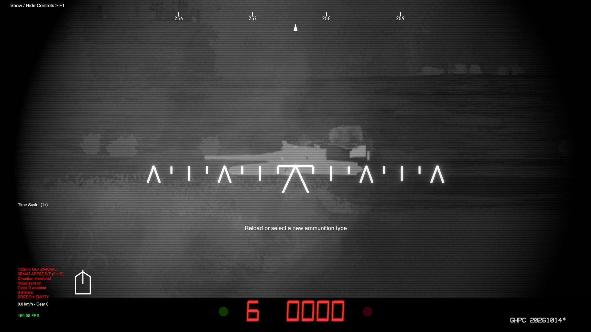
</p>
<p align="center">
  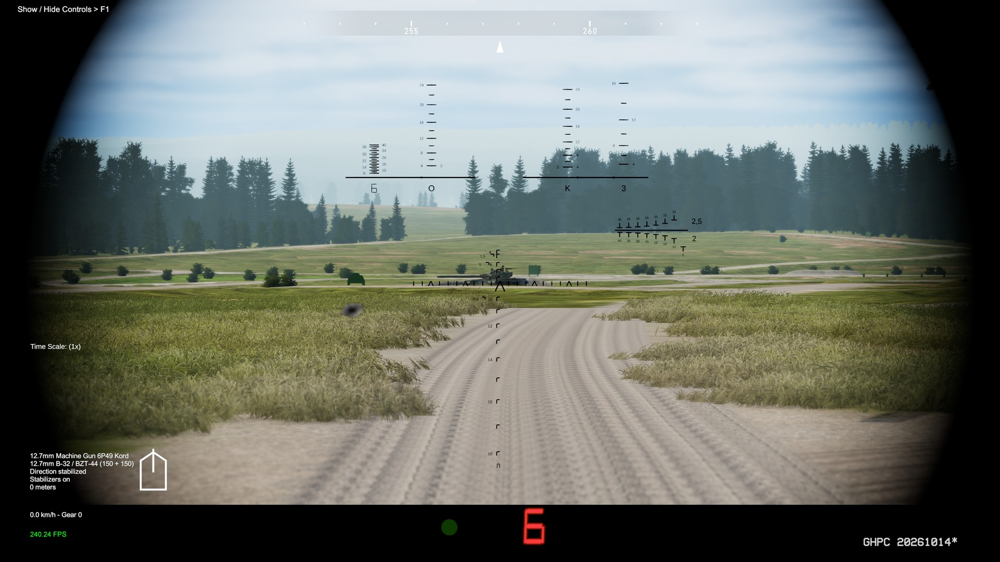
  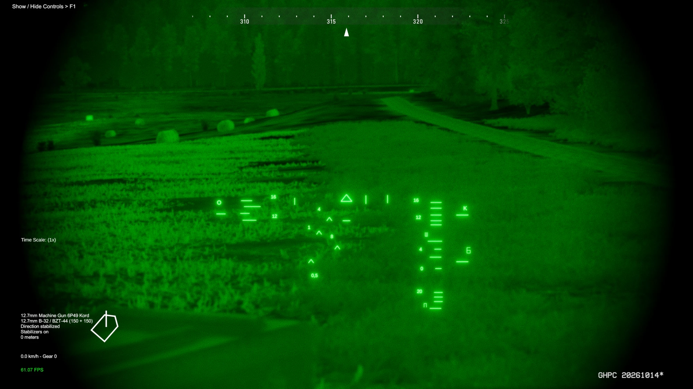
</p>

*Top: the gunner's 1G46 by day and the ESSA thermal sight. Bottom: the commander's TKN-4S, day and night channels.*

- **1G46 gunner's sight + 1A45T fire control:** 2.7-12x, stabilised in both planes independently of the gun like the
  real one, line of sight -15° / +20°, laser rangefinder, and the range and ammo readout under the picture.
- **Night sight:** the **ESSA** thermal imager (default, most T-90As from 2006: 9 × 6.75° / 3 × 2.25°, electronic x2
  zoom, grey monitor image) or the **Buran-M** image intensifier of the first 32 tanks (2004), on its own stabilised
  head (-10° / +20°).
- **Commander's TKN-4S "Agat-S":** day and night channels, each with its own reticle, drawn from a photo of the real
  reticle and the PNK-4S manual: aiming chevron, lead marks, stadiametric rangefinder, the Kord's ballistic scale and the
  ammo / ready indicator at the bottom. Switch to it with the game's "Cycle View" key; looking through it, you aim and
  fire the remote Kord.

## The paint

<p align="center">
  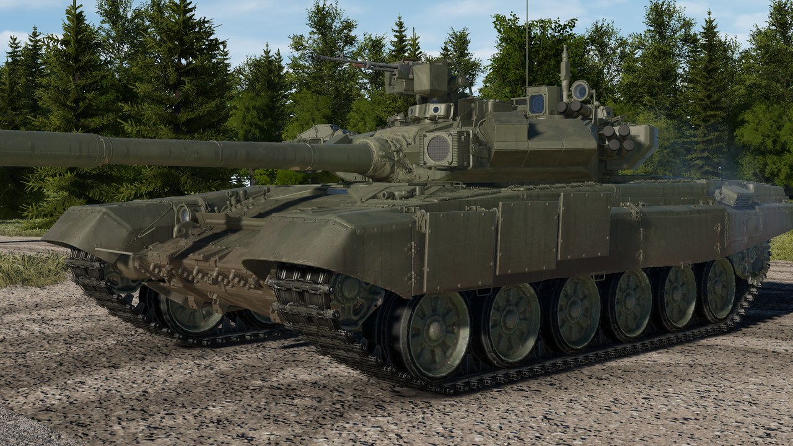
  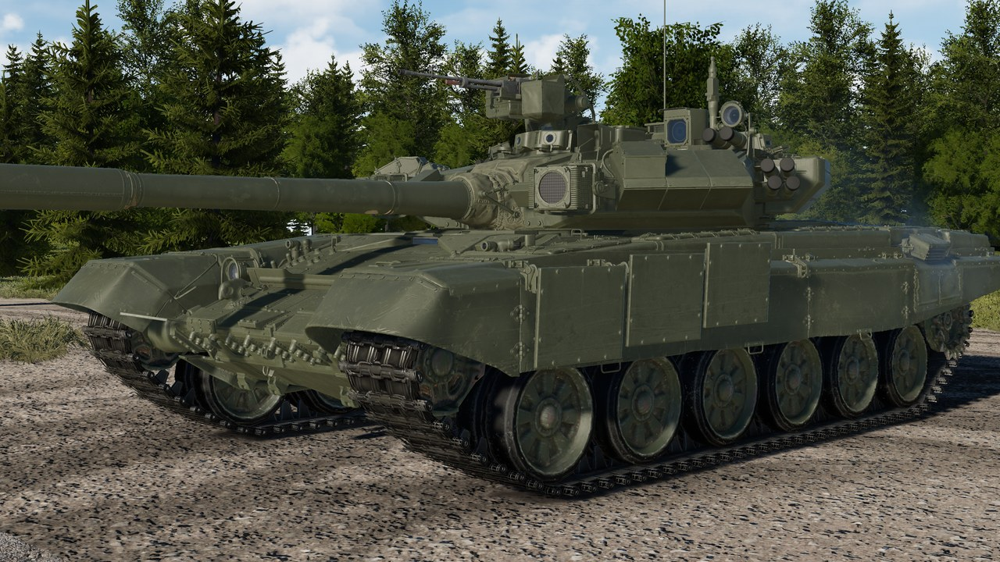
</p>

*Left: the default weathered paint. Right: `Weathered paint` set to false.*

The weathering is made for the T-90A's own shape: dust and mud heavier toward the ground, grime in the crevices,
streaks down the sides, rust running down from bolts and edges at the back, chipped edges. If you'd rather have a
factory-fresh tank, set `Weathered paint` to false (see Settings below).

## Where the model comes from

The 3D model and textures are War Thunder's T-90A, taken from War Thunder's game files. They belong to Gaijin
Entertainment, and they're not covered by this repository's license. Everything else (the armour, the sights and their
reticles, the fire control, the ammo, the interior, the values) was built for GHPC, from Russian sources.

## Bugs and suggestions

I'm open to suggestions, fixes, better sources, pull requests, whatever you've got. If you know something about the real
T-90A that the mod gets wrong, tell me.

Found a bug? Open an [issue](../../issues) and attach `MelonLoader\Latest.log` from the game folder. The mod writes a
warning there whenever something couldn't be fitted.

---

## More details

Click to open.

<details>
<summary><b>Settings</b></summary>

After the first start, `UserData\MelonPreferences.cfg` in the game folder has a `[T-90A]` section (close the game
before editing it):

| Setting | Values | Default |
|---|---|---|
| `Enabled` | true / false | true |
| `Add to campaign roster` | true / false | true |
| `Campaign prevalence` | how common it is (1 = as common as a typical tank) | 0.5 |
| `Campaign unlock after missions` | number | 2 |
| `APFSDS` | `"3BM42"` / `"3BM60"` (where the game doesn't pick one itself) | 3BM42 |
| `Gunner night sight` | `"ESSA"` / `"Buran-M"` | ESSA |
| `ESSA electronic zoom` | true / false | true |
| `Armour preset` | `"game-scale"` / `"source-only"` | game-scale |
| `Weathered paint` | true (dirt, wear and rust) / false (clean factory paint) | true |

In Instant Action and the campaign, the T-90A gets its own APFSDS choice (3BM42 or 3BM60) in the game's normal
ammo menu.

The few parts the T-90A borrows from the base game (T-80B sight sounds and voices, the T-64B's machine-gun station, the
M60A3 TTS thermal screen effect) are copied once from the game's own files, so another mod freeing those vanilla assets
later doesn't break it.

</details>

<details>
<summary><b>The remote Kord</b></summary>

The T-90A's commander fires a 12.7 mm Kord from under armour, hatch closed:

- 2 belts of 150 (three B-32 armour-piercing incendiary to one BZT-44 tracer), 625 rounds/min. The cupola turns with
  it at up to 35°/s (45° left / 60° right of the gun), the Kord elevates -5° / +70° at 24°/s.
- **PZU-7** sight for semi-automatic mode, or the **TKN-4S** in "Avtomat" mode: stabilised, follows the sight, range keys
  set the superelevation.
- Drives, sight and barrel can be knocked out. The ammo belt flexes as the gun elevates.

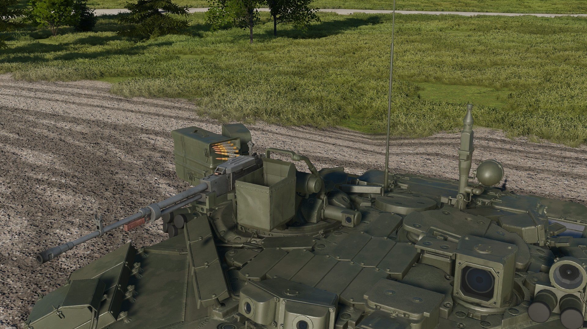

</details>

<details>
<summary><b>Mobility, gun and ammo</b></summary>

| | |
|---|---|
| Engine | V-92S2, 1000 hp at 2000 rpm, T-72 gearbox |
| Speed | 60 km/h forward, 4.2 km/h reverse (the real gearbox's reverse) |
| Turret traverse / gun elevation | 24°/s / 28°/s |
| Gun limits | -6°13′ / +13°47′ over the front, less depression over the engine deck |
| Autoloader | 6.5 s, 22 rounds in the carousel |
| Main gun ammo | 42 rounds: 3BM42 or 3BM60, 3BK18M HEAT, 3OF26 HE-Frag, 9M119M Invar |
| Coax PKT | 2000 rounds (8 belts of 250) |
| Smoke | 12 × 902B "Tucha" |

| Round | Penetration |
|---|---|
| 3BM42 "Mango" (default) | ~580 mm at the muzzle, ~460 mm at 2 km |
| 3BM60 "Svinets-2" | ~690 mm at the muzzle, ~600 mm at 2 km |
| 9M119M "Invar" | 700 mm, tandem warhead (sets off ERA first), 100-5000 m, guided along the gunner's sight line |
| 3BK18M HEAT, 3OF26 HE-Frag | the game's own rounds |

</details>

<details>
<summary><b>What's not exactly like the real tank, and why</b></summary>

| What | In the mod | Why |
|---|---|---|
| Base vehicle | Built on the game's T-72M1 (running gear, hull internals, autoloader, diesel) | The T-90 *is* a T-72 development. GHPC has no Soviet T-72, so the army, voices, sight sounds and HUD come from the T-80B. |
| Armour strength | "game-scale" by default | Keeps the T-90A in the right place next to GHPC's own tanks. "source-only" is one setting away. Only the strength changes, not the layout. |
| Turret side | 70 / 80 mm | btvt gives 70. Russian Wikipedia's 110 is uncited and probably counts an optional add-on plate the model doesn't have. |
| TKN-4S "Dubl" mode | not built | The commander can't fire the main gun from the TKN-4S. Its main-gun scales are still drawn where they are on the real reticle. |
| TKN-4S night field of view, Kord drive speeds | best guesses | Nothing published. |
| Kord for the AI | AI T-90As don't use it | Kept simple; your commander does. |
| Shtora-1 | modelled, not functional | GHPC has nothing it could plug into. |
| Autoloader | 6.5 s for every round | GHPC has one reload time per gun. |

</details>

<details>
<summary><b>Building from source</b></summary>

This repository holds the mod's C# source (.NET Framework 4.7.2). You need the .NET SDK (6 or newer) and GHPC with
MelonLoader installed (the build references the game's assemblies):

```
dotnet build -c Release -p:GameDir="<GHPC folder>\Bin"
```

`GameDir` is the folder with `GHPC.exe` in it (defaults to the usual Steam location). The DLL ends up in
`bin\Release\T90A.dll`. The asset bundle (`Mods\T90A\t90a`: model, textures, armour) isn't built from this source; take
it from the release zip.

Layout: `T90A\` the mod, `Common\` the helpers it's built with, `Resources\` data embedded in the DLL.

</details>

## License

The source code in this repository is under the [GNU General Public License v3.0](LICENSE). The 3D model and textures
in the release zip are War Thunder's (Gaijin Entertainment) and are not covered by it.
