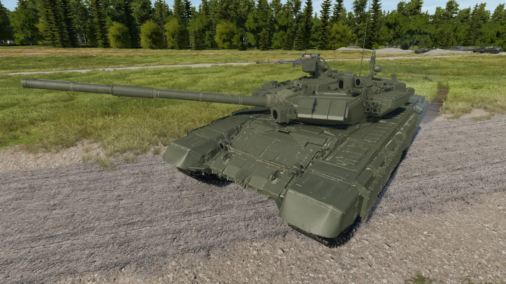
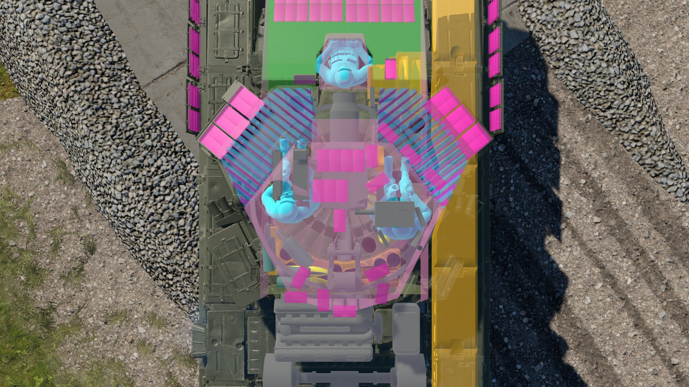
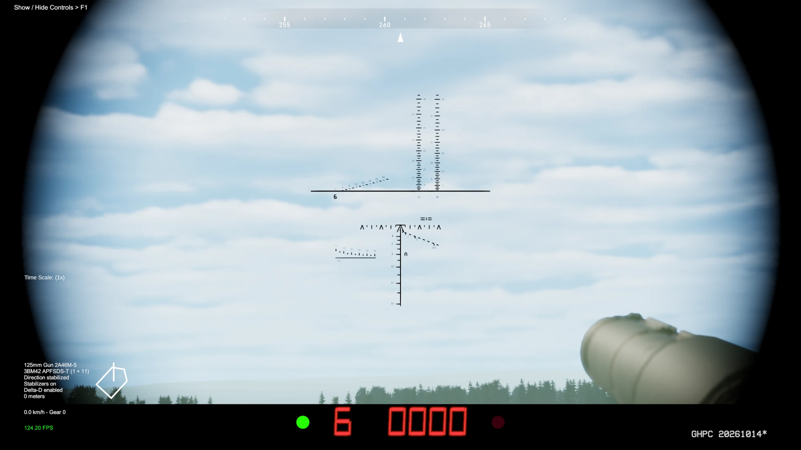
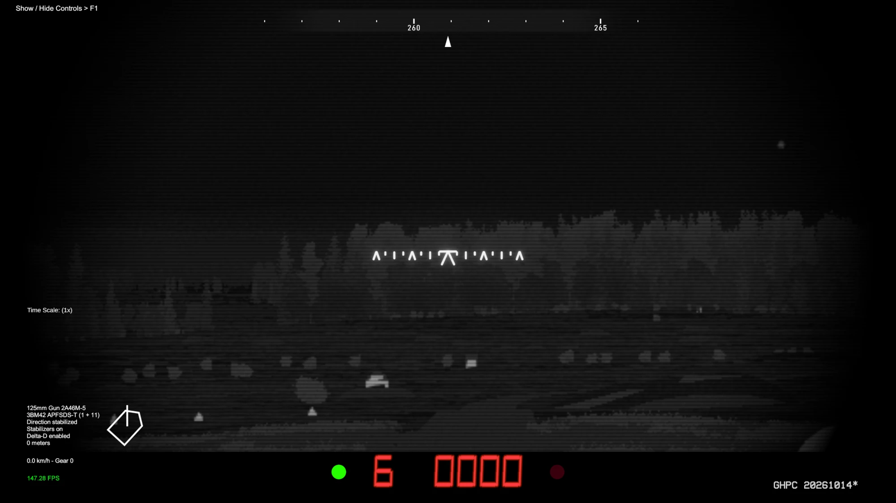
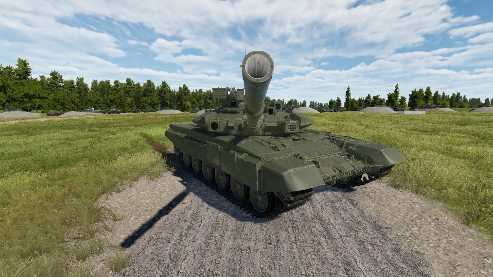
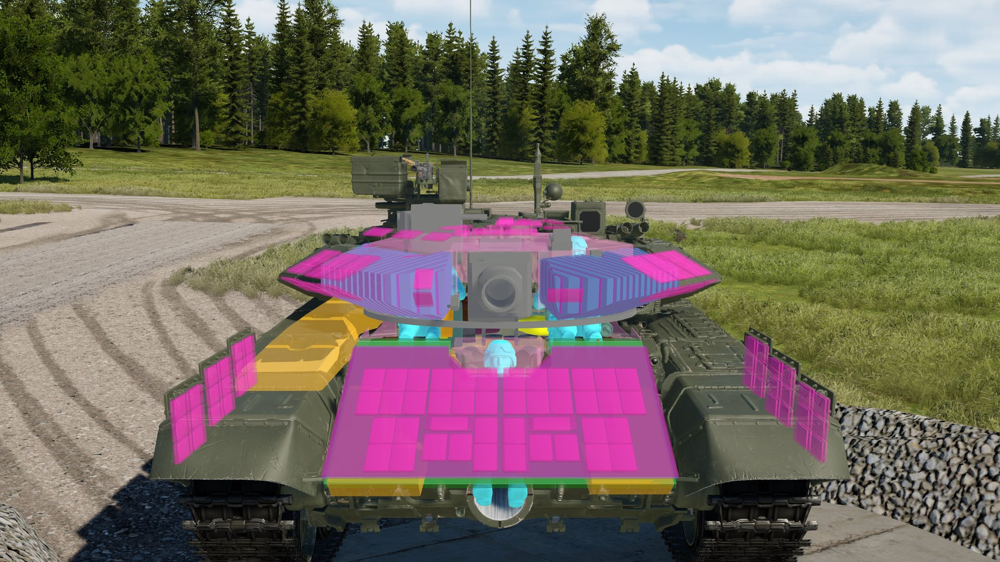
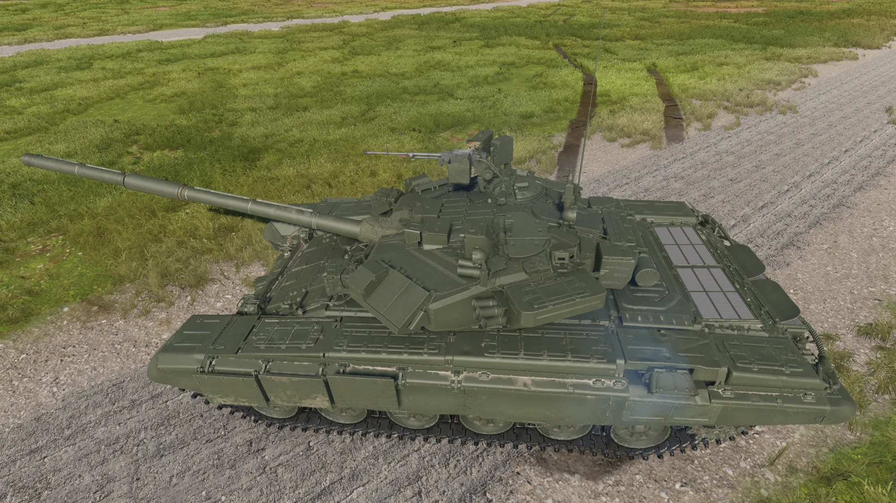
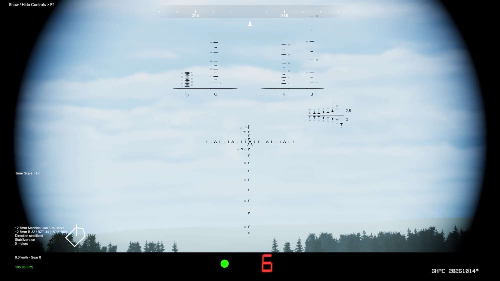

# T-90A for Gunner, HEAT, PC!

The Russian **T-90A** main battle tank as its own unit in GHPC, built to be as close to the real tank as the game allows.



**[Download the latest release](../../releases/latest)** · No other mod needed · MelonLoader

- **Welded turret with its real armour, layer by layer**: 19 plate packages in each cheek, the T-90 glacis stack,
  Kontakt-5. Every layer has its own colour in the hit x-ray and its own name in the hit text.
- **1A45T fire control and the 1G46 sight** (2.7-12x), stabilised independently of the gun.
- **ESSA thermal sight**, or the early Buran-M image intensifier.
- **Remote 12.7 mm Kord** on a turning cupola, with the PZU-7 and the commander's TKN-4S (stabilised "Avtomat" mode).
- **3BM42 or 3BM60 APFSDS, 3BK18M HEAT, 3OF26 HE-Frag and the 9M119M Invar** missile (tandem, defeats ERA).
- Soviet crew and markings. In Instant Action, the mission editor and the Soviet campaign.
- **Researched in Russian sources.** Where the game forced a compromise, it's listed below with the reason.

<p align="center">
  
  
  
</p>

## Installation

1. Install [MelonLoader](https://melon-loader.com/) into GHPC if it isn't already.
2. Download `T90A_<version>.zip` from [Releases](../../releases/latest).
3. Copy the `Mods` folder from the archive into the game folder, the one that holds `GHPC.exe` (Steam: right-click
   GHPC > Manage > Browse local files).
4. Start the game.

To uninstall, delete `Mods\T90A.dll` and the `Mods\T90A` folder.

<details>
<summary><b>Settings</b></summary>

After the first start, `UserData\MelonPreferences.cfg` in the game folder has a `[T-90A]` section (close the game
before editing it):

| Setting | Values | Default |
|---|---|---|
| `Enabled` | true / false | true |
| `Add to campaign roster` | true / false | true |
| `Campaign prevalence` | how common it is (1 = as common as a typical tank) | 0.5 |
| `Campaign unlock after missions` | number | 2 |
| `APFSDS` | `"3BM42"` / `"3BM60"` | 3BM42 |
| `Gunner night sight` | `"ESSA"` / `"Buran-M"` | ESSA |
| `ESSA electronic zoom` | true / false | true |
| `Armour preset` | `"game-scale"` / `"source-only"` | game-scale |

No other mod is needed. The T-90A takes the few parts it borrows from the base game (T-80B sight sounds and voices,
T-64B machine-gun station, M60A3 TTS thermal screen effect) from the game's own files and keeps its own copies once
loaded, so another mod freeing those vanilla assets later doesn't break it.

</details>

## Bugs and suggestions

Open an [issue](../../issues). Include `MelonLoader\Latest.log` from the game folder: the mod writes a warning there
whenever something could not be fitted.

---

## In depth

For those who want to know how it was built and why. Click a section to open it.

<details>
<summary><b>How accurate is it?</b></summary>

This mod was built with one rule: **realism first**. Where realism and convenience pulled apart, the real equipment won,
even when a part then does nothing in the game. Where the game itself made a real value impossible or unfair, the
concession is listed (see "Decisions and concessions") with its reason. Nothing is hidden.

**Sources.** Russian-language sources first, because that is where the Soviet / Russian equipment is documented: S. Suvorov's
book on the T-90, manual-style excerpts on the 1G46, 1A45 and PNK-4S on *"Одетые в броню"*, btvt.info / btvt.narod.ru,
andrei_bt's research on turret fillings, Russian Wikipedia, and the welded-turret patent RU 2112914 (UKBTM, 1996). Where
sources disagree, the conflict is noted and the better-supported value used. Where nothing was found, the value is
marked as unsourced (in the code, next to the value) and taken from the closest real equivalent.

</details>

<details>
<summary><b>Armour</b></summary>



### Protection values (line of sight, mm RHA equivalent, without ERA)

| | Turret (cheeks) | Upper glacis | Kontakt-5 |
|---|---|---|---|
| **game-scale** (default) | 690 KE / 820 HEAT | 550 / 750 | +190 / +550 |
| **source-only** | 575 / 750 | 500 / 650 | +190 / +550 |

**Why two presets, and why "game-scale" is the default.** GHPC rates its own tanks on its own scale, and open-source
figures for a modern tank are not on that scale. "game-scale" puts the T-90A on the game's scale, so it compares with
the game's T-72s and T-80s the way the other tanks compare with each other. "source-only" uses the open-source figures
as they are, for players who prefer them. Switch it in the settings. Only the strength changes between the two: the
layers and their layout are the same.

### The welded turret and its cheek filling

The T-90A has a **welded** turret, not the T-72's cast one. GHPC has no welded turret to borrow, so it was built plate by
plate:

- **The steel plates are the visible model's own outer faces.** Fronts 65 mm, side walls 70 / 80 mm, the cheek's rear
  wall 150 mm (btvt.info), roof 45 / 60 mm, rear 76 mm.
- **The real cheek filling.** Each cheek cavity holds **19 packages of "reflecting plates"**, standing on edge across the
  cavity, square to the walls, as in the section drawings of the welded turret. Each package: a 50 mm SK-2Sh
  high-hardness plate, 6 mm of rubber and two 4 mm steel plates, with spacer gaps between packages (andrei_bt,
  btvt.info). Every layer is its own armour piece.
- **Protection depends on how many plates your round crosses.** Most of the cheek reads about 690 KE (game-scale), but a
  round can meet anything from 540 to 925 depending on where it lands, rather than one number everywhere. This is how a
  real plate filling behaves, so it was kept.

<p align="center">
  
  
</p>

*The game's hit x-ray: the plate packages in both cheeks (blue), Kontakt-5 (magenta), the anti-radiation lining (pink).*

### The upper glacis

The T-72B obr. 1989 / T-90 stack, in its real thicknesses: 60 mm BTK-1Sh steel | rubber 5 + steel 3 | air 19 | steel 3
+ rubber 5 | 60 mm BTK-1Sh | 10 mm polypropylene | 50 mm BTK-1Sh, at 68° (Russian Wikipedia's layer table, *"Одетые в
броню"*, andrei_bt). The base T-72M1's slot between its outer and rear plates measures exactly the 105 mm these middle
layers need. The T-72M1's glass-textolite layer and its 16 mm add-on plate are removed (no T-90A has them).

### Mantlet, ring and bottom plate

- **Mantlet**: a solid block whose strength comes from its real depth: 420 KE / 505 HEAT straight at the bore, thinner
  where the model is thinner.
- **Turret bottom plate**: the flange round the turret ring is a solid of the model's own shape (8-41 cm of steel
  depending on where it is hit), not a thin sheet.
- **Kontakt-5**: 190 KE / 550 HEAT. A block that has gone off is spent: a second hit on the same spot meets only the armour
  behind it.

### Weak spots (kept on purpose)

Real tanks have weak zones, and this one keeps its own:

- **The recesses beside the gun mask** are shallower than the gun mask itself, so they are weaker (about 160-250 KE). The
  strength comes from the model's own depth there, calibrated at the bore. No source gives a value for these recesses.
- **The band under the cheeks, at the turret ring**, is the turret's bottom plate, not composite. The welded-turret
  patent has the filler cavities resting on that plate, so the composite really does stop there. No source gives the
  plate's thickness, so its strength comes from the model's shape. A well-aimed APFSDS round can get through there, as
  through the ring zone of most tanks.
- **The cheek's inner edge, beside the mantlet**: a round there crosses only the corners of a few plates, or a spacer gap.
  That is what a plate filling does at its edge.

</details>

<details>
<summary><b>Fire control and sights</b></summary>

### 1G46 gunner's sight and 1A45T

- 2.7-12x, line of sight **stabilised in both planes, independently of the gun**, as on the real sight.
- **Line of sight -15° / +20°** (1G46 manual excerpt).
- Range and ammunition readout under the field of view, ballistic computer for every round, laser rangefinder.

### Night sight: ESSA (default) or Buran-M

| | ESSA (default) | Buran-M (option) |
|---|---|---|
| Type | Thermal imager, 8-12 µm, Catherine-FC camera | 3rd-generation image intensifier |
| Fields of view | 9 × 6.75° / 3 × 2.25°, electronic x2 zoom 1.5 × 1.12° | as the T-80B's TPN-3-49 |
| Shown on | a monitor (grey image, switchable polarity) | an eyepiece |
| On which tanks | T-90A from 2006 (most of them) | the first 32 T-90A (2004) |

The ESSA is the default because most T-90As carried it. The Buran-M is there for the early tanks.

<p align="center">
  
  
</p>

*Left: the 1G46 at 12x with its range and ammunition readout. Right: the ESSA thermal sight, narrow field.*

</details>

<details>
<summary><b>Commander's station: the remote Kord</b></summary>

The T-90A's commander fires a 12.7 mm machine gun from under armour, with the hatch closed. In the mod:

- **6P49 Kord**, 2 belts of 150 rounds, 625 rounds/min.
- **The cupola turns with it**: 45° left / 60° right of the gun line (Suvorov's text on the ZPU drive); the Kord
  elevates -5° / +70°.
- **PZU-7** sight (1.2x, 50° field) for semi-automatic mode.
- **TKN-4S "Agat-S"** commander's sight (day 7.5x, night channel), switched with the game's "Cycle View" key. Looking
  through it puts the Kord in **Avtomat** mode: stabilised, following the sight, -4° / +20°, with range keys that set
  the Kord's superelevation.
- **The TKN-4S reticle** is drawn from a photo of the real reticle and the PNK-4S manual's figure of the field of view:
  aiming chevron, lead marks, stadiametric rangefinder, the Kord's ballistic scale, and the ammo-type / ready indicator
  at the bottom.
- The drives, the sight and the barrel can all be damaged.
- The ammunition belt flexes between the box and the gun as the Kord elevates.



<p align="center">
  
  
</p>

*The TKN-4S: day channel with the ballistic scales and rangefinder, and the night channel with its own reticle.*

</details>

<details>
<summary><b>Mobility, crew and ammunition</b></summary>

| | Value | Source / note |
|---|---|---|
| Engine | V-92S2, 1000 hp | |
| Top speed | 60 km/h | |
| Turret traverse | 24°/s | |
| Gun limits | -7° / +20° | |
| Autoloader | 6.5 s, 22-round carousel | |
| Main gun rounds | 42 (22 APFSDS / 8 HEAT / 8 HE-Frag / 4 missiles) | total from Russian Wikipedia; the split is a default |
| Coax PKT | 2000 rounds in 8 belts of 250 | Russian Wikipedia |
| Smoke | 12 × 902B "Tucha" | |

| Round | Penetration in the mod |
|---|---|
| 3BM42 "Mango" (default) | 550 mm at the muzzle, ~440 mm at 2 km |
| 3BM60 "Svinets-2" (option, late / upgraded T-90A) | 740 mm at the muzzle, ~600 mm at 2 km |
| 9M119M "Invar" | 900 mm behind ERA, tandem warhead (sets off the ERA block first), 5 km |
| 3BK18M HEAT, 3OF26 HE-Frag | the game's own rounds |

</details>

<details>
<summary><b>Decisions and concessions</b></summary>

Everything that is **not** exactly as on the real tank, and why.

| What | Real T-90A | In the mod | Why |
|---|---|---|---|
| Base vehicle | – | Built on the game's T-72M1: running gear, hull internals, crew positions, autoloader, diesel | The T-90 *is* a T-72 development: these are the right family. GHPC has no Soviet T-72 (all its T-72s are East German), so the army, markings, voices, sight sounds and HUD come from the T-80B. |
| Reverse speed | 4.8 km/h | 16 km/h | Every tank in GHPC reverses at 16 km/h, including the Soviet ones. The real value would make the T-90A the only tank that crawls backwards. |
| Gun elevation speed | not found | 25°/s | No source gives it; the T-80B's late-Soviet stabiliser value is used. |
| Armour scale | open-source figures | "game-scale" by default | Keeps the T-90A in the right relation to GHPC's own tanks (see "Armour"). "source-only" is one setting away. |
| Turret side | 70 mm (btvt.info); 110 mm (Russian Wikipedia, uncited) | 70 / 80 mm | The 110 mm is unsourced, and probably counts an optional add-on side plate from the turret patent. The model has no such plate, so it isn't added. |
| Turret rear, bustle floor, bottom plate | rear 76 mm (low confidence); floor and bottom plate not found | rear 76, floor 45 mm, bottom plate from the model's shape | Best available; the unsourced ones are marked as such. |
| Hull armour | – | The T-72M1's, fitted onto the T-90A's hull plates; the glacis replaced by the T-90 stack | The T-90A hull is a T-72 hull. Every gap left in the hull armour (floor-level transmission, engine-deck grilles) is also open on the vanilla T-72M1, so it stays as on that tank; at the rear and on the roof there are fewer than on the T-72M1. |
| TKN-4S "Dubl" mode | The commander can fire the main gun and coax through the TKN-4S | Not built: only the Kord fires through it | Out of scope. The reticle's main-gun and coax scales are still drawn, exactly where the photo and manual show them, because they are on the real reticle. They don't move. |
| TKN-4S night channel | field of view not published | 11.5°, reticle angles inferred from the manual's unscaled drawing | Nothing better exists. The night lead marks are drawn but not reliable for leading. |
| TKN-4S / Kord drive speeds, sight positions | not published | taken from the model and the game's T-64B remote MG station | The T-64B's NSVT station (the closest real equivalent in GHPC) was the donor. |
| Kord for the AI | – | AI T-90As don't use the Kord | Kept simple; the player's commander does. |
| Shtora-1 | dazzlers, laser warning, aerosol screen | modelled on the tank, not functional | GHPC has no system it could plug into. |
| Autoloader | ~8 s for the missile, longer to change round type | 6.5 s for every round | GHPC has one reload time per gun; the carousel wait already makes type changes slower. |
| Main gun rounds | – | 42, stowed in the T-72M1's 44 slots | The real number; the base vehicle's racks hold them. |

</details>

<details>
<summary><b>Building from source</b></summary>

This repository holds the mod's C# source (.NET Framework 4.7.2). You need the .NET SDK (6 or newer) and GHPC with
MelonLoader installed (the build references the game's assemblies):

```
dotnet build -c Release -p:GameDir="<GHPC folder>\Bin"
```

`GameDir` is the folder that holds `GHPC.exe` (it defaults to the usual Steam location). The DLL is written to
`bin\Release\T90A.dll`. The asset bundle (`Mods\T90A\t90a`: models, textures, armour) is not built from this source;
take it from the release archive.

Layout: `T90A\` the mod, `Common\` the helpers it is built with, `Resources\` data embedded in the DLL.

</details>

## License

The source code in this repository is licensed under the [GNU General Public License v3.0](LICENSE). The 3D model and
textures in the release archive are not covered by it.
