# T-90A for Gunner, HEAT, PC!

A Russian **T-90A** you can actually drive and fight in GHPC, as its own unit. Welded turret, Kontakt-5, 1G46 sight,
ESSA thermal, Shtora-1, the remote Kord on the commander's cupola, 3BM42 / 3BM60 and the Invar missile.

I made this mod for myself first, but you're welcome to use it too.

<p align="center">
  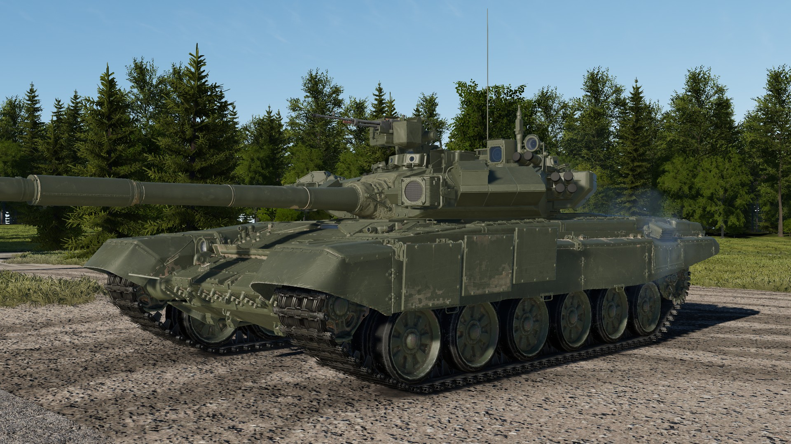
  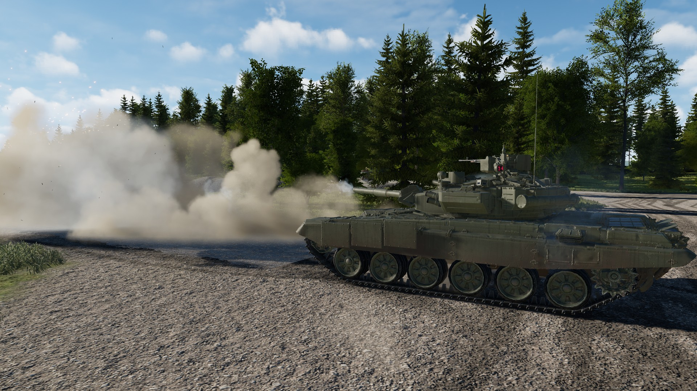
</p>

This README describes **version 0.4.2**. No other mod needed, just MelonLoader.

## What's in it

- **Armour built for GHPC**, from Russian sources, laid plate by plate onto the T-90A's own hull and turret, with
  Kontakt-5 on top.
- **The real sights**: the gunner's 1G46 with the 1A45T fire control, the ESSA thermal (or the Buran-M), and the
  commander's TKN-4S, reticles drawn from the real ones.
- **Shtora-1, all of it working**: an IR jammer against wire- and radio-guided missiles, laser warning on the
  commander's panel, and automatic aerosol screens.
- **The remote Kord** on the cupola, fired from under armour, belt feeding and spent cases included.
- **42 rounds**, 22 in the carousel and the spares in the T-72B manual's places, the 3BM60 and the Invar as their own
  models.
- **Weathered paint** made for the T-90A's own shape, or clean factory paint if you'd rather.

AI T-90As use the sights, Shtora-1 and the ammo the same way you do. Only the Kord is yours alone.

## Installing it

1. Get [MelonLoader](https://github.com/LavaGang/MelonLoader/releases) (0.7.3 or newer) into GHPC if you don't have it already.
2. Download `T90A_<version>.zip` from [Releases](../../releases/latest).
3. Copy the `Mods` folder from the zip into the game folder, the one with `GHPC.exe` in it (Steam: right-click GHPC >
   Manage > Browse local files). You should end up with:
   ```
   Mods\T90A.dll
   Mods\T90A\t90a
   ```
4. Start the game. The T-90A is in **Instant Action** (unit "T-90A"), in the **Soviet
   campaign** roster, and in the "Showcase of most playable vehicles" mission.

Once per game start the mod asks GitHub whether there's a newer release, and if there is, it puts one line in the
MelonLoader console with a link to the releases page. Nothing in game, nothing gets downloaded or installed, and if
you're offline it just doesn't say anything. Set `Check for updates` to false (Settings, below) to turn it off.

To remove it, delete `Mods\T90A.dll` and the `Mods\T90A` folder. That's safe mid-campaign too, the game's campaign
save doesn't keep a list of units, so nothing in it points at the T-90A.

## "It's a War Thunder model, does it even work in GHPC?"

Yes. Only the **looks** come from War Thunder. Everything that decides what happens when a round hits was built for
GHPC, on GHPC's own rules:

- **It's GHPC armour.** The same kind of armour pieces the vanilla tanks use, laid onto the T-90A's own plates. No War
  Thunder armour value is used anywhere, War Thunder was only a checklist of what parts exist.
- **It's covered all round.** The turret has no gaps from any direction, turned or not. The hull is the T-72's (which
  the T-90's really is), and the few gaps it has are the ones the vanilla T-72M1 has too.
- **The inside works like a vanilla tank.** Engine, transmission, drives, sights, fire control, radio, the Shtora
  lamps and each of the 12 smoke tubes are damageable modules wired into the game's own systems, so knocking out a
  sight does what it does on any vanilla tank.
- **It's been shot at properly.** Hundreds of rounds in game, all over the tank, next to a vanilla T-72M1 getting the
  same, checking where every round stopped.
- **The AI handles it like a vanilla tank.** It picks ammo and shoots at the T-72M1's and T-80B's pace, and it burns and
  cooks off the same way.
- **It fits in.** The game's own glass, the vanilla paint finish, smoke tube caps that pop off on a salvo, and a lighter
  model at range so it costs no more to draw than a vanilla tank.

<p align="center">
  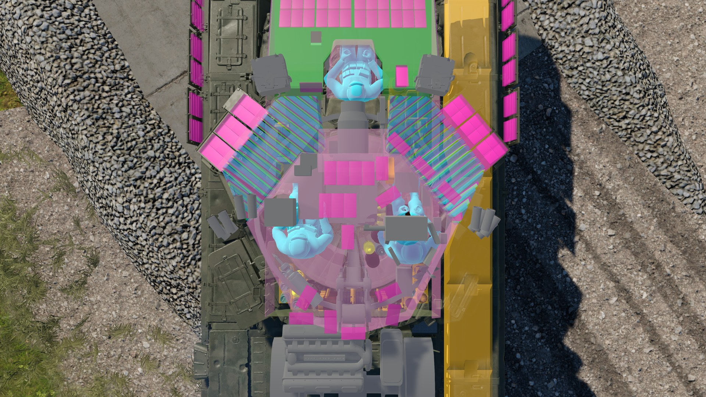
  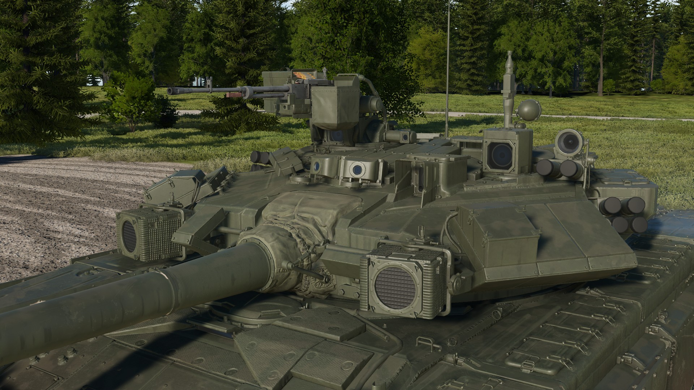
</p>

*Left: the hit x-ray from above, every armour layer in its own colour: the plate packages in both cheeks, the crew
(light blue), the modules (grey) and the ammo. Right: the sight windows, the Shtora lenses and the smoke tube caps.*

## The armour

Line-of-sight protection straight from the front, in mm of steel, **without ERA**:

| | Turret cheeks (vs APFSDS / vs HEAT) | Upper glacis (vs APFSDS / vs HEAT) |
|---|---|---|
| **T-90A (this mod)** | **690 / 819** | **549 / 748** |
| T-80B (vanilla) | 595 / 669 | 485 / 602 |
| M1IP (vanilla) | 516 / 999 | 348 / 361 |

Kontakt-5 adds about **140 / 550** on top.

A Kontakt-5 brick only goes off for something that's worth it. Machine-gun and autocannon rounds up to 30 mm, and
fragments and spall, leave it whole, which is what btvt and the Russian papers on the real brick (4S22) say. The one
exception is the fragments of a bigger HE shell bursting within 10 m of it. GHPC on its own sets ERA off on any hit, a
PKT round included. A brick that has gone off still looks whole by default. With `ERA destruction effects` on (Settings,
below) it blows open with a blast, charred inside, lid thrown off, the plate round it sooted and the nets over it cut.

*Median over a grid of straight-on shots. The T-90A measured in game on its cheek block and glacis, the vanilla tanks
from their armour in the game's files over the whole cheek face, so their thin edges pull their median down a bit.*

Fired in game straight at the front (ERA on, turret straight and turned 17°):

| | T-90A | vanilla T-72M1 |
|---|---|---|
| 3BM42 at the upper glacis | stopped inside the glacis | goes through |
| 3BM42 at the turret cheek | stopped by the cheek | stopped by the turret |
| 3BK18M HEAT at the turret cheek | stopped in the cheek packages | stopped by the turret |
| 9M119M Invar at the turret cheek | stopped by the cheek | depends on where it lands |

<details>
<summary><b>Where the armour design comes from</b></summary>

It's based on **real Russian documents I found online**, not on how it looks in War Thunder:

- **Turret cheeks:** 19 packages of "reflecting plates" in each cheek (a 50 mm SK-2Sh plate, 6 mm of rubber and two
  4 mm plates each), standing on edge across the cavity between a 65 mm outer wall and a 150 mm inner wall. From
  andrei_bt's research on T-72 / T-90 filler packages, btvt.info, and the UKBTM welded-turret patent RU 2112914. The
  22 mm gaps between the packages are real too, but a round in the game has no width, so one flying along the plates
  could slip down a gap and meet almost nothing. The rubber and thin-plate layer runs on through each gap, so it gets
  about what it would crossing them.
- **Upper glacis:** the T-72B obr. 1989 / T-90 stack, layer by layer: 60 mm steel, rubber, steel plates with an air gap,
  60 mm steel, polypropylene, 50 mm steel. From Russian Wikipedia's «Т-90» article, the "Одетые в броню" forum and
  andrei_bt.
- **How strong it is overall:** Russian estimates for the T-90 turret (about 800-830 mm vs APFSDS with Kontakt-5) with
  the ERA taken off, plus the 10-15 % btvt gives the T-90A's welded steel over the cast turret. Kontakt-5 from the maker
  (NII Stali) and btvt.
- **Where nothing could be found** (bustle floor, turret bottom plate, a few small things), the value comes from the
  closest real equivalent or from the model's own shape, and it says so in the source.

There's also a "source-only" armour setting if you'd rather have the lower open-source figures (575 / 750 on the
cheeks).

</details>

### Weak spots

The upper glacis and the main face of the cheeks stop 3BM42, 3BK18M and the Invar, and the glacis still does with its
ERA already gone. Away from those, it has the holes every T-72 descendant has, so if you're fighting one, or trying to keep
one alive, this is where it goes wrong.

Straight from the front, from my test firing (turret straight and turned 17°):

| Spot | vs APFSDS | 3BM42 | 3BK18M HEAT | Invar |
|---|---|---|---|---|
| Lower front plate | ~200 mm | through | through, all the way back | borderline |
| Mantlet, next to the gun | ~320 mm | through on the right, coin toss on the left | stopped by the breech | stopped by the breech |
| Mantlet / cheek join, ~30 cm either side of the gun | ~210 mm | through on the right, depends on the left | usually through on the right | through |
| Turret ring, the strip above the glacis | ~290 mm | through | stopped | usually stopped |

- **The sight heads** on the roof front are thin. APFSDS and the Invar go through and out the back without reaching
  the crew, but the sight's gone.
- **The cheek's inner edge**, where it meets the mantlet, stops APFSDS and HEAT, the Invar gets through with a bit left.
- **Along the cheek plates**, about 50° off the nose, a couple of spots let a 3BM42 through with around 50 mm left.
- **From the side it's a T-72.** The hull behind the skirts stops nothing a tank fires, and on the left that's
  straight into the carousel. The right side by the driver stops HEAT only. The bustle sides are the same.
- **From above** at 60°, anything a tank fires goes through the turret roof and the engine deck.

## The ammo inside

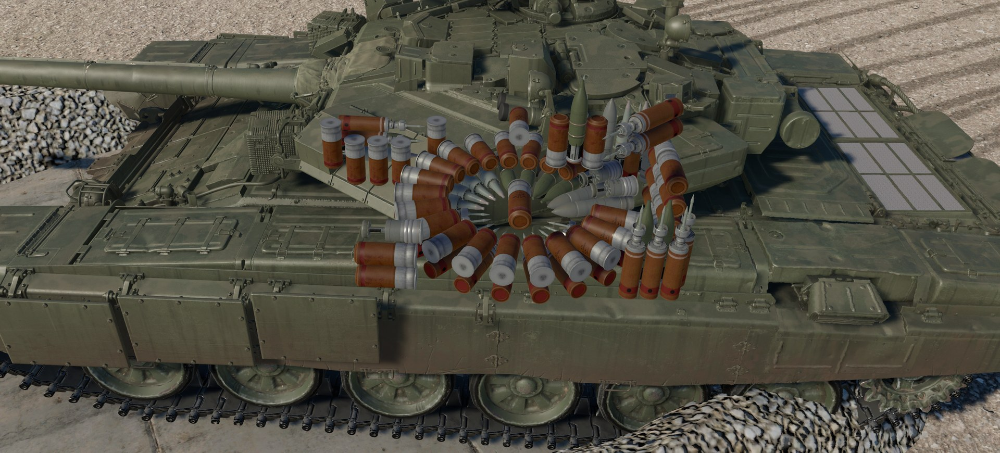

*Pressing O: the carousel's ring under the turret, the spares round it, the Invar missiles (grey-green) and the 3BM60s.*

42 rounds, stowed where the real tank keeps them:

- **22 in the autoloader's carousel** under the turret floor.
- **20 spares** in the T-72B manual's places: against the rear bulkhead, at the front right beside the driver, along
  the left wall and on the turret's rotating floor, each group in its own rack.
- **The rounds look like the real ones.** The 3BM60 has its own longer rod and sabot, the Invar is its own missile with
  the 9Kh949 charge instead of the game's Kobra, and each has the right stencils. They're made from the game's own round
  models, so they don't look out of place next to the vanilla shells.

## The sights

<p align="center">
  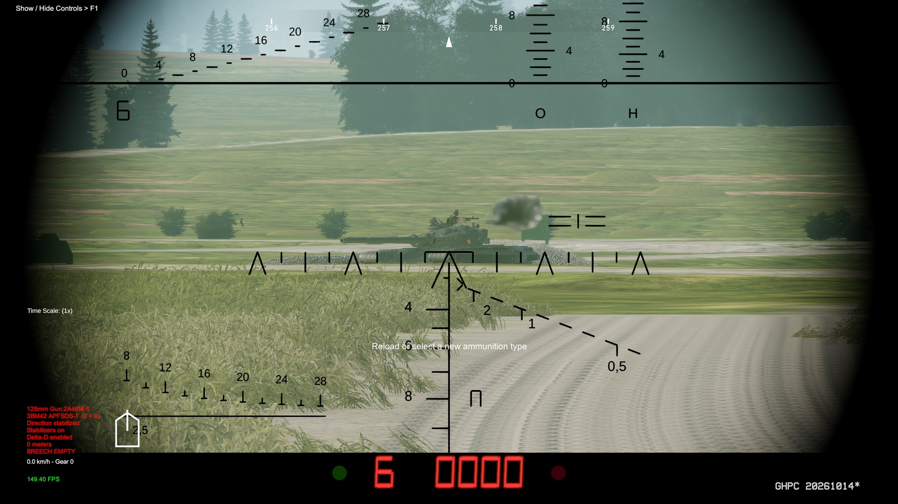
  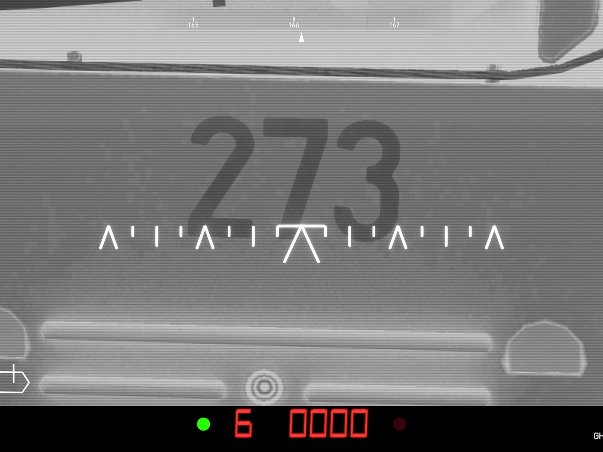
</p>
<p align="center">
  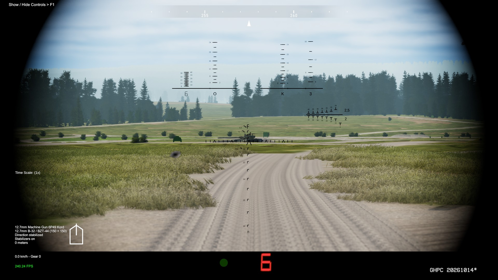
  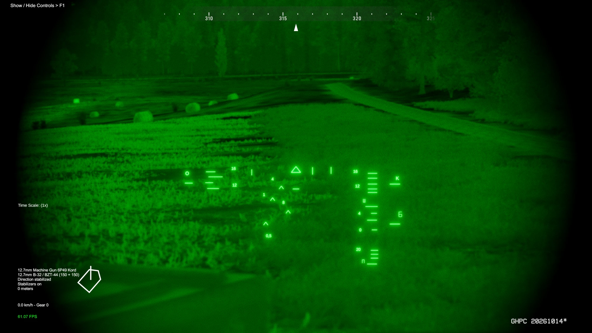
</p>

*Top: the gunner's 1G46 by day and the ESSA thermal. Bottom: the commander's TKN-4S, day and night channels.*

- **1G46 + 1A45T fire control** for the gunner: 2.7-12x, stabilised independently of the gun like the real one, laser
  rangefinder, range and ammo readout under the picture.
- **ESSA** thermal (default, most T-90As from 2006), shown the way the gunner actually sees it: the camera's 754 x 576
  on a 4:3 CRT monitor, scan lines and black bars either side. Or, as a setting, the **Buran-M** image intensifier of the first 32 tanks.
- **TKN-4S "Agat-S"** for the commander, day and night channels with reticles drawn from a photo of the real one and the
  PNK-4S manual. It's also how you aim the remote Kord.

<details>
<summary><b>Sight details</b></summary>

- **1G46:** line of sight -15° / +20°, stabilised in both planes. The sight can run up to 8° ahead of the turret
  sideways, the real head's travel, and the turret catches up. Its head is the low hooded box on the roof in front of
  the gunner's hatch.
- **ESSA:** 9 × 6.75° / 3 × 2.25°, electronic x2 zoom, up to 7.5° ahead of the turret. **Buran-M** (2004): on its own
  stabilised head, -10° / +20°. The night sight's head is the tall box behind the 1G46's.
- **TKN-4S:** aiming chevron, lead marks, stadiametric rangefinder, the Kord's ballistic scale and the ammo / ready
  indicator at the bottom. Select the Kord and you're straight in it ("Cycle View" goes to the PZU-7 and back).

</details>

## Shtora-1

<p align="center">
  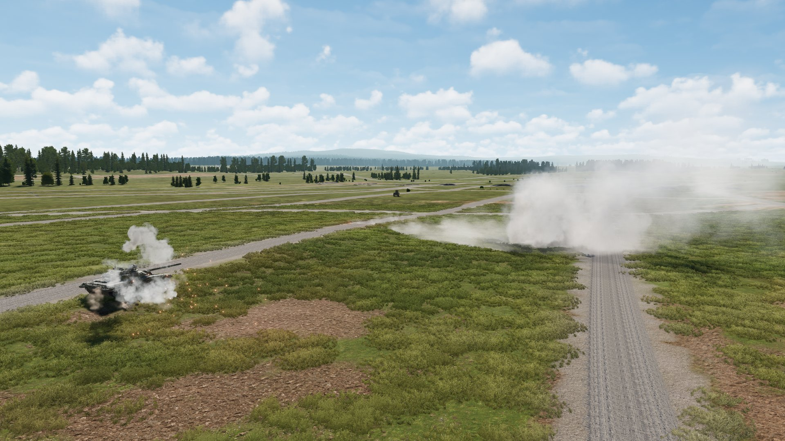
  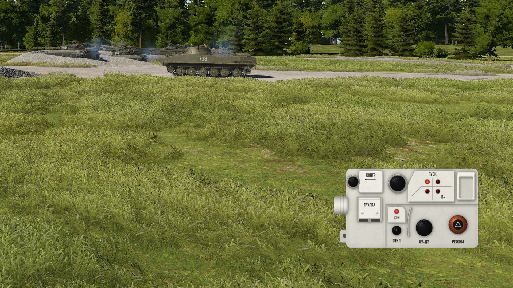
</p>

*Left: a laser from the front, and the T-90A puts a 3D17 screen between itself and the shooter. Right: the commander's
control panel, a lamp showing where the laser came from.*

The T-90A's soft-kill system. It doesn't shoot anything down, it messes with how the other guy aims:

- **Missiles steered from the launcher** (TOW, HOT, MILAN, Fagot, Konkurs, Kobra and co.) coming in within 20° of where
  your gun points go wide about 6 times in 10.
- **Get lased** and the commander's panel pops up bottom right with a warning tone and a lamp for the direction. The
  direction is taken from where the turret points, not the hull.
- **Lased from in front of the turret**, a white cloud goes up between you and the shooter by itself, and a tank lasing through it
  has to judge the range by eye.

AI T-90As have all of it too: lase one from the front and it screens itself, lase it from the side and it turns its
turret towards you. All of it can be switched off or toned down in the settings.

<details>
<summary><b>How the jammer works</b></summary>

The two red lamps either side of the gun (the TShU-1-7 emitters) are the jammer. A missile like a TOW has a flare on its
tail, and the launcher tracks that flare to steer the missile onto the sight line. The lamps flash modulated infrared
that looks like the flare, and as the missile flies away its own flare gets fainter while the lamps don't. Once the
lamps are brighter, the launcher locks onto them instead, steers with the wrong picture, and the missile goes off into
the dirt.

- It works on missiles guided that way: TOW, HOT, MILAN, and the Soviet Fagot, Konkurs, Kobra, Falanga and Shturm.
  Anything else it leaves alone.
- Only within ±20° of the gun sideways and a couple of degrees up and down, so point the gun at the threat. It's no
  force field either.
- Only on missiles actually fired at you by the other side. One aimed at the tank next to you, or one of your own
  side's, flies on as normal.
- It's on from the start. AI crews switch theirs on when they're fighting or getting shot at.
- Each lamp is a module and can be shot off. With one gone it works on that side only.

</details>

<details>
<summary><b>The laser warning and the screens</b></summary>

Four heads on the turret watch for lasers, and they turn with it: two precise ones covering 45° either side of where the
turret points, two coarse ones for the rest of the circle. They see from 5° below to 25° above the turret's level, a
laser from higher than that isn't seen.

- **The panel** is the PU TShU-1M, drawn after a photo of the real one. Its four red lamps are the heads' sectors, all
  relative to the turret: top row front left / front right (up to 45° off the turret's axis), bottom row rear left /
  rear right (the rest of that side). Looking through a sight it shrinks into the black strip under
  the picture. A new warning while the tone's still going doesn't cut it off, the lamps just follow the new one.
- **From the front, in automatic mode**, it fires a 3D17 grenade from the tube pointing closest to the laser. It goes
  out 50-80 m, bursts after a second, and the cloud builds up in about 3 s and hangs for about 20 s. It blocks lasers
  and eyes, not thermal sights (the real one is made for visible light and near infrared).
- **From the side or rear** you only get the warning, because a coarse head can't tell where to aim a screen. The
  vehicle menu then has **Turn to Laser** for 20 s, which swings the turret round until a precise head sees it, and if
  they're still lasing you the screen goes up from there.
- **What it does to the shooter:** an AI tank whose laser is blocked loses its rangefinder and judges the range by eye,
  give or take 10 %. Honestly against APFSDS at 1600 m that barely matters, the round's flat enough to hit anyway. It
  matters more for slower rounds like HEAT, and the cloud hides you while it stands.

The screen won't go up when a hatch is open, when you fired the main gun in the last 15 s (the real system holds the
screens after your own shot), when there's already a cloud on that line, or when you're out of grenades or the tubes are
knocked out (a destroyed tube's grenade can't be fired by anything until it's repaired).

</details>

<details>
<summary><b>Using it: the vehicle menu and the weapon info</b></summary>

- **Vehicle menu > Shtora-1:** Toggle IR Jammer, Aerosol Screen (fires one where the gun points, grenades left in
  brackets), Screen Mode (AUTO, or SEMI where you get the warning and fire the screen yourself), and Turn to Laser
  after a side or rear warning.
- **Weapon info, bottom left:** a `Shtora-1:` line with the jammer (on, off, "on, left only" / "on, right only" once a
  lamp's gone) and the screen mode, and a `Shtora-1 screen:` line under it: "ready" with the grenades left, or why it's
  held (hatch open, own shot with the seconds left, no grenades). For a few seconds after a warning that brought no
  screen it says why: laser from the side, or a cloud already there.
- **Settings:** `Shtora-1` and the five after it (see Settings below).

</details>

## The paint

<p align="center">
  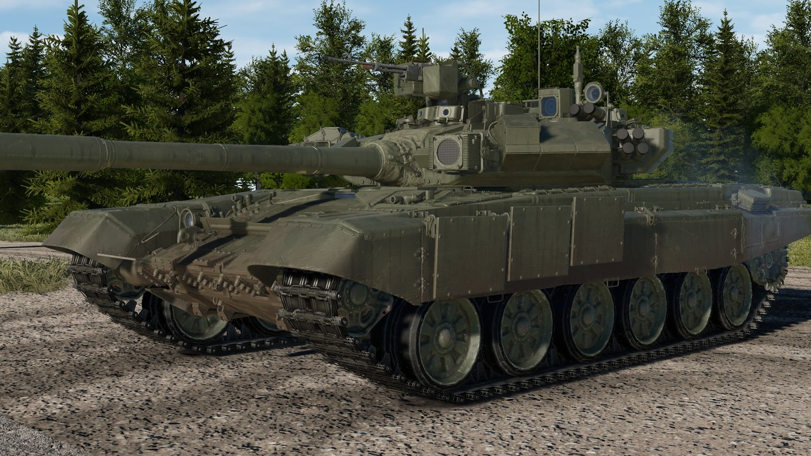
  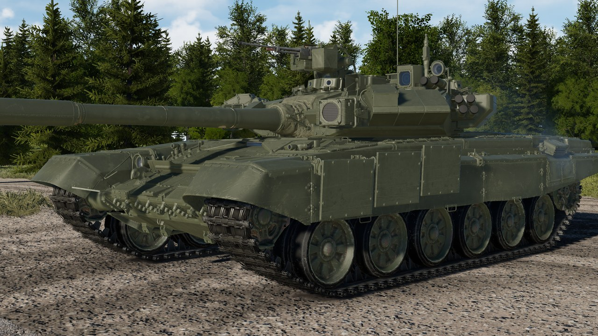
</p>

*Left: the default weathered paint. Right: `Weathered paint` set to false.*

Dust and mud heavier toward the ground, grime in the crevices, streaks down the sides, rust running from bolts and edges
at the back, chipped edges, all made for the T-90A's own shape.

## Bugs and suggestions

I'm open to suggestions, fixes, better sources, pull requests, whatever you've got. If you know something about the real
T-90A that the mod gets wrong, tell me.

Found a bug? Open an [issue](../../issues) and attach `MelonLoader\Latest.log` from the game folder. The mod writes a
warning there whenever something didn't load right, a game update has renamed something it uses, or one of its hooks
into the game failed (the game carries on without it).

---

## More details

Click to open.

<details>
<summary><b>Settings</b></summary>

After the first start, `UserData\MelonPreferences.cfg` in the game folder has a `[T-90A]` section (close the game
before editing it):

| Setting | Values | Default |
|---|---|---|
| `Enabled` | true / false | true |
| `Add to campaign roster` | true / false | true |
| `Campaign prevalence` | how common it is (1 = as common as a typical tank) | 0.5 |
| `Campaign unlock after missions` | number | 2 |
| `APFSDS` | `"3BM42"` / `"3BM60"` (where the game doesn't pick one itself) | 3BM60 |
| `Gunner night sight` | `"ESSA"` / `"Buran-M"` | ESSA |
| `ESSA electronic zoom` | true / false | true |
| `Armour preset` | `"game-scale"` / `"source-only"` | game-scale |
| `Weathered paint` | true (dirt, wear and rust) / false (clean factory paint) | true |
| `Shtora-1` | true (jammer, laser warning panel, automatic aerosol screens) / false (none of it: the game's ordinary smoke salvo) | true |
| `Shtora-1 automatic screens` | true (a laser from the front fires a screen by itself) / false (semi-automatic: warning and panel only, you fire the screen from the vehicle menu or with the smoke key) | true |
| `Shtora-1 alarm tone` | true (the laser warning sounds a tone) / false (the panel's lamps only) | true |
| `Shtora-1 jammer on at spawn` | true (the jammer is on from the start) / false (off until you switch it on in the vehicle menu, AI crews still switch it on in combat) | true |
| `Shtora-1 panel on screen` | true (the control panel shows on a laser warning) / false (no panel, the tone only) | true |
| `Shtora-1 panel always on screen` | false (the panel comes up on a warning and goes away after) / true (always on screen while you're in the T-90A) | false |
| `Kord spent cases` | true (the Kord throws out its spent cases, they lie on the tank) / false (no cases, the belt still feeds) | true |
| `ERA destruction effects` | false (a brick that's gone off looks as before, it still works as armour once) / true (it blows open with a blast, charred, lid thrown, plate sooted, nets over it cut, the cheek stowage boxes gone with it) | false |
| `Check for updates` | true (asks GitHub once per game start, one line in the MelonLoader console if there's a newer release) / false (no check) | true |

There's also a `ConfigVersion` line at the end, the version that last wrote the section. Leave it alone, it's how the
mod tells which settings are still on an old default.

If your Windows uses a decimal comma and a settings editor saved a number as text (`"Campaign prevalence" = "0,3"`),
the mod reads it anyway, with a comma or a point, and says so in the log. MelonLoader on its own would quietly use the
default instead.

In Instant Action and the campaign, the T-90A gets its own APFSDS choice (3BM42 or 3BM60) in the game's normal
ammo menu.

The three campaign settings take effect at the next mission load, no restart needed: switch `Add to campaign roster`
off and the T-90A comes out of the roster, change the prevalence or unlock and the roster follows.

The few parts the T-90A borrows from the base game (T-80B sight sounds and voices, the T-64B's machine-gun station, the
M60A3 TTS thermal screen effect) are copied once from the game's own files, the first time a T-90A spawns, or at the
main menu if those vehicles would be unloaded again before then.

</details>

<details>
<summary><b>The remote Kord</b></summary>

The T-90A's commander fires a 12.7 mm Kord from under armour, hatch closed:

- 2 belts of 150 (three B-32 armour-piercing incendiary to one BZT-44 tracer), 625 rounds/min. The cupola turns with
  it at up to 35°/s (45° left / 60° right of the gun), the Kord elevates -5° / +70° at 24°/s.
- **PZU-7** sight for semi-automatic mode, or the **TKN-4S** in "Avtomat" mode: stabilised, follows the sight, range keys
  set the superelevation. Selecting the Kord opens the TKN-4S, "Cycle View" swaps to the PZU-7. You only aim and fire it
  from those two sights, not from the commander's free-look head view.
- Drives, sight and barrel can be knocked out. The ammo belt flexes as the gun elevates.
- Firing, the belt feeds into the gun round by round, and the spent cases go out of the chute on the right, forward
  like on the real 6P49. They land on the tank and stay there until it tilts or brakes hard enough to shake them off.
  Don't want them? Set `Kord spent cases` to false.

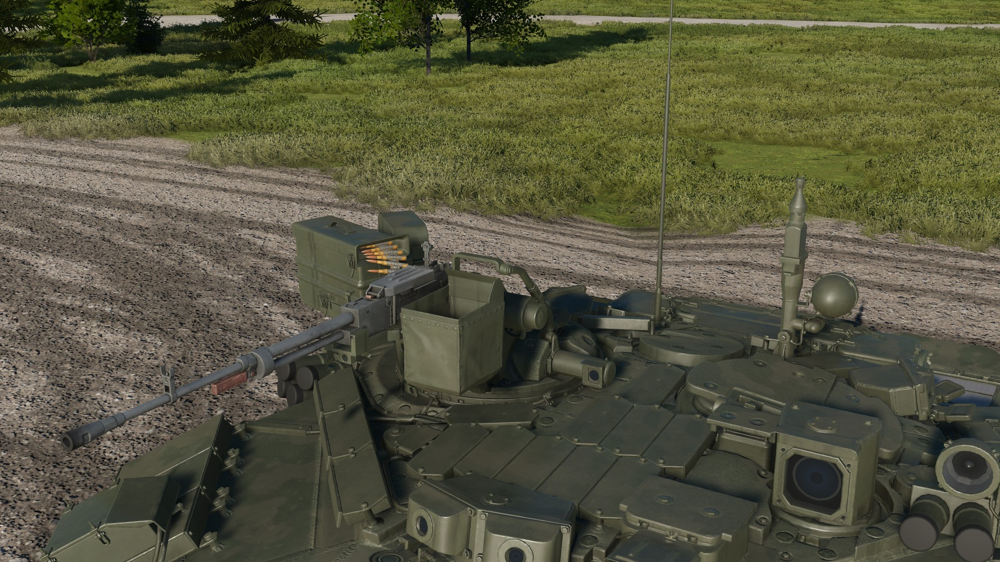

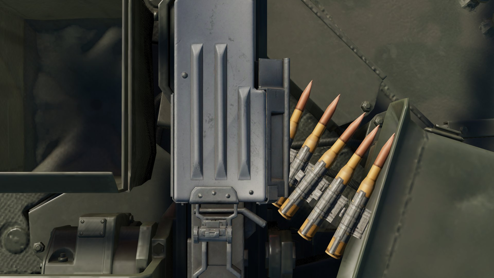

</details>

<details>
<summary><b>Mobility, gun and ammo</b></summary>

| | |
|---|---|
| Engine | V-92S2, 1000 hp at 2000 rpm, T-72 gearbox |
| Speed | 60 km/h forward, 4.2 km/h reverse (the real gearbox's reverse) |
| Turret traverse / gun elevation | 24°/s / 28°/s |
| Gun limits | -6°13′ / +13°47′ over the front, less depression over the engine deck |
| Autoloader | 6.5 s, 22 rounds in the carousel |
| Main gun ammo | 42 rounds: 3BM42 or 3BM60, 3BK18M HEAT, 3OF26 HE-Frag, 9M119M Invar |
| Coax PKT | 2000 rounds (8 belts of 250) |
| Smoke | 12 × 902B "Tucha", 3D17 aerosol grenades (each tube can be knocked out) |

| Round | Penetration |
|---|---|
| 3BM42 "Mango" | ~580 mm at the muzzle, ~460 mm at 2 km |
| 3BM60 "Svinets-2" (default) | ~690 mm at the muzzle, ~600 mm at 2 km |
| 9M119M "Invar" | 700 mm, tandem warhead (sets off ERA first), 100-5000 m, guided along the gunner's sight line |
| 3BK18M HEAT, 3OF26 HE-Frag | the game's own rounds |

</details>

<details>
<summary><b>What's not exactly like the real tank, and why</b></summary>

| What | In the mod | Why |
|---|---|---|
| Base vehicle | Built on the game's T-72M1 (running gear, hull internals, autoloader, diesel) | The T-90 *is* a T-72 development. GHPC has no Soviet T-72, so the army, voices, sight sounds and HUD come from the T-80B. |
| Armour strength | "game-scale" by default | Keeps the T-90A in the right place next to GHPC's own tanks. "source-only" is one setting away. Only the strength changes, not the layout. |
| Turret side | 70 / 80 mm | btvt gives 70. Russian Wikipedia's 110 is uncited and probably counts an optional add-on plate the model doesn't have. |
| TKN-4S "Dubl" mode | not built | The commander can't fire the main gun from the TKN-4S. Its main-gun scales are still drawn where they are on the real reticle. |
| TKN-4S night field of view, Kord drive speeds | best guesses | Nothing published. |
| Kord for the AI | AI T-90As don't use it | Kept simple, your commander does. |
| Shtora-1 jammer | breaks a missile's guidance 6 times in 10 | 0.6 is the published figure for MILAN and HOT. The same chance is used for TOW and the Soviet missiles. |
| Shtora-1 panel lamps | top row = the front heads, bottom row = the rear heads, left / right | The real panel has four lamps in a square, but no source I found says which lamp means what, so that's inferred from the four heads. The mode knob is drawing only. |
| Shtora-1 own-shot hold | 15 s | The sources give the hold but not a clean figure, 15 s is the middle of what they suggest. |
| Spare round racks | frames, trays and cups in the T-72B manual's places | The places are from the manual, the racks' shapes are a best guess. |
| Kontakt-5 that's gone off (`ERA destruction effects` on) | an empty open container, lid off on the outside | The War Thunder model has no set-off brick, so the look is a best guess. |
| Autoloader | 6.5 s for every round | GHPC has one reload time per gun. |

</details>

<details>
<summary><b>Building from source</b></summary>

This repository holds the mod's C# source (.NET Framework 4.7.2). You need the .NET SDK (6 or newer) and GHPC with
MelonLoader installed (the build references the game's assemblies):

```
dotnet build -c Release -p:GameDir="<GHPC folder>\Bin"
```

`GameDir` is the folder with `GHPC.exe` in it (defaults to the usual Steam location). The DLL ends up in
`bin\Release\T90A.dll`. The asset bundle (`Mods\T90A\t90a`: model, textures, armour) isn't built from this source, take
it from the release zip.

Layout: `T90A\` the mod, `Common\` the helpers it's built with, `Resources\` data embedded in the DLL.

</details>

## Where the model comes from, and the license

The 3D model and textures are War Thunder's T-90A, taken from War Thunder's game files. They belong to Gaijin
Entertainment and they're not covered by this repository's license. Everything else (the armour, the sights and their
reticles, the fire control, the ammo, the interior, the values) was built for GHPC, from Russian sources.

The source code in this repository is under the [GNU General Public License v3.0](LICENSE).
