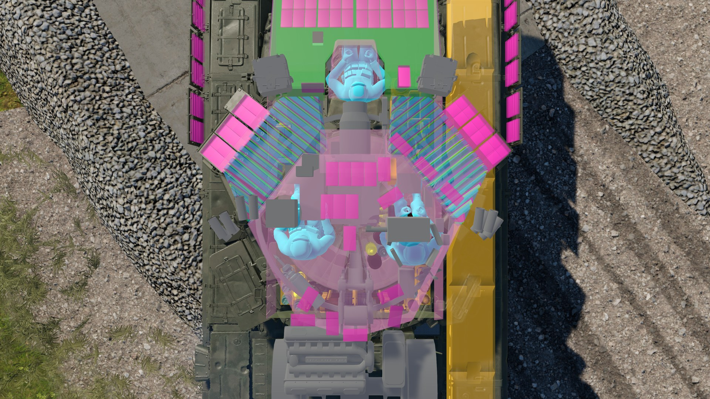
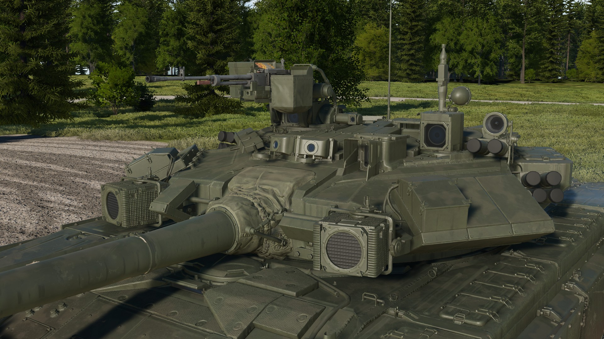

# The armour

How the T-90A's armour is put together, where the numbers come from and where it goes wrong. The short version is in
the [README](../README.md#armour-protection).

## War Thunder's shapes, my numbers

The armour pieces, hull and turret, are cut from War Thunder's damage model of the T-90A and replace the T-72M1's outer
armour. None of War Thunder's armour values is used. Every thickness and strength comes from the Russian sources further
down, apart from the few plates no source gives a thickness for, which are as thick as the model draws them. Where the
model doesn't match the real tank it's been cut up: War Thunder has the welded turret as one solid lump, and here it's
split into the real plates with the cheek cavities filled by the 19 plate packages.

In game it's ordinary GHPC armour, the same kind the vanilla tanks use and hit by the same rules. The turret has no
gaps from any direction, turned or not. Under the T-90A's armour the hull is still the T-72's, which the real T-90's is
too.

Inside it works like a vanilla tank. Engine, transmission, drives, sights, fire control, radio, the Shtora lamps and
each of the 12 smoke tubes are damageable modules wired into the game's own systems, so knocking out a sight does what
it does on any vanilla tank. The AI picks ammo and shoots at the T-72M1's and T-80B's pace, and it burns and cooks off
the same way.

  
  

*Left: the hit x-ray from above, every armour layer in its own colour, the plate packages in both cheeks, the crew
(light blue), the modules (grey) and the ammo. Right: the sight windows, the Shtora lenses and the smoke tube caps.*

## Where the design comes from

The numbers, and what's inside the cheeks and the glacis, come from **real Russian documents I found online**:

- **Turret cheeks:** 19 packages of "reflecting plates" in each cheek (a 50 mm SK-2Sh plate, 6 mm of rubber and two
  4 mm plates each), standing on edge across the cavity between a 65 mm outer wall and a 150 mm inner wall. From
  andrei_bt's research on T-72 / T-90 filler packages, btvt.info, and the UKBTM welded-turret patent RU 2112914. The
  22 mm gaps between the packages are real too, but a round in the game has no width, so one flying along the plates
  could slip down a gap and meet almost nothing. The rubber and thin-plate layer runs on through each gap, so it gets
  about what it would crossing them.
- **Upper glacis:** the T-72B obr. 1989 / T-90 stack, layer by layer: 60 mm steel, rubber, steel plates with an air gap,
  60 mm steel, polypropylene, 50 mm steel. From Russian Wikipedia's «Т-90» article, the "Одетые в броню" forum and
  andrei_bt.
- **How strong it is overall:** Russian estimates for the T-90 turret (about 800-830 mm vs APFSDS with Kontakt-5) with
  the ERA taken off, plus the 10-15 % btvt gives the T-90A's welded steel over the cast turret. Kontakt-5 from the maker
  (NII Stali) and btvt.
- **Where nothing could be found** (bustle floor, turret bottom plate, a few small things), the value comes from the
  closest real equivalent or from the model's own shape, and the code says so.

The default preset is "game-scale", which keeps the T-90A in the right place next to GHPC's own tanks. `Armour preset`
= "source-only" gives the lower open-source figures instead (575 / 750 on the cheeks). Only the strength changes, not
the layout.

## How it compares

Line-of-sight protection straight from the front, in mm of steel, **without ERA**:

| | Turret cheeks (vs APFSDS / vs HEAT) | Upper glacis (vs APFSDS / vs HEAT) |
|---|---|---|
| **T-90A (this mod)** | **690 / 819** | **549 / 748** |
| [T-80UM2](https://github.com/marsattackk/GHPC-T80UM2) (my other mod) | 744 / 984 | 485 / 653 |
| T-80B (vanilla) | 595 / 669 | 485 / 602 |
| M1IP (vanilla) | 516 / 999 | 348 / 361 |

Median over a grid of straight-on shots. The T-90A and the T-80UM2 were measured in game on their cheek block and
glacis. The vanilla tanks were read from their armour in the game's files over the whole cheek face, so their thin
edges pull their median down a bit.

For the T-72M1 it replaces, the same figures without ERA are 471 on the cheeks and 452 on the glacis.

## Kontakt-5

Kontakt-5 adds about **140 / 550** on top. A brick only goes off for something that's worth it. Machine-gun and
autocannon rounds up to 30 mm, fragments and spall all leave it whole, which is what btvt and the Russian papers on the
real brick (4S22) say. The one exception is the fragments of a bigger HE shell bursting within 10 m of it. GHPC on its
own sets ERA off on any hit, a PKT round included.

By default a brick that's gone off still looks whole. With `ERA destruction effects` on it blows open with a blast,
charred inside, lid thrown off, the plate round it sooted and the nets over it cut. The War Thunder model has no
set-off brick, so that look is a best guess.

## Test firing

Fired in game straight at the front (ERA on, turret straight and turned 17°):

| | T-90A | vanilla T-72M1 |
|---|---|---|
| 3BM42 at the upper glacis | stopped inside the glacis | goes through |
| 3BM42 at the turret cheek | stopped by the cheek | stopped by the turret |
| 3BK18M HEAT at the turret cheek | stopped in the cheek packages | stopped by the turret |
| 3BK29M HEAT at the turret cheek | stopped by the cheek | goes into the turret |
| 3BK31 HEAT at the turret cheek | stopped by the cheek | stopped by the turret |
| 9M119M Invar at the turret cheek | stopped by the cheek | depends on where it lands |
| 3BK31 HEAT at the upper glacis | stopped inside the glacis | goes through |
| 3BM42 at the upper glacis, its ERA gone | through, about 35 mm left | goes through (it has no ERA) |
| 3BK31 HEAT at the upper glacis, its ERA gone | goes through | goes through |

## Weak spots

If you're fighting one, or trying to keep one alive, this is where it goes wrong. Straight from the front, from my test
firing (turret straight and turned 17°):

| Spot | vs APFSDS | 3BM42 | 3BK18M HEAT | Invar |
|---|---|---|---|---|
| Lower front plate | ~200 mm | through | through, all the way back | borderline |
| Mantlet, next to the gun | ~320 mm | through on the right, coin toss on the left | stopped by the breech | stopped by the breech |
| Mantlet / cheek join, ~30 cm either side of the gun | ~210 mm | through on the right, depends on the left | usually through on the right | through |
| Turret ring, the strip above the glacis | ~290 mm | through | stopped | usually stopped |

- **The sight heads** on the roof front are thin. APFSDS and the Invar go through and out the back without reaching
  the crew, but the sight's gone.
- The cheek's inner edge, where it meets the mantlet, stops APFSDS and HEAT. The Invar gets through with a bit left.
- Along the cheek plates, about 50° off the nose, a couple of spots let a 3BM42 through with around 50 mm left.
- **From the side it's a T-72.** The hull behind the skirts stops nothing a tank fires, and on the left that's
  straight into the carousel. The right side by the driver stops HEAT only. The bustle sides are the same.
- From above at 60°, anything a tank fires goes through the turret roof and the engine deck.

The turret side is 70 / 80 mm. btvt gives 70, and Russian Wikipedia's 110 is uncited and probably counts an optional
add-on plate the model doesn't have.
