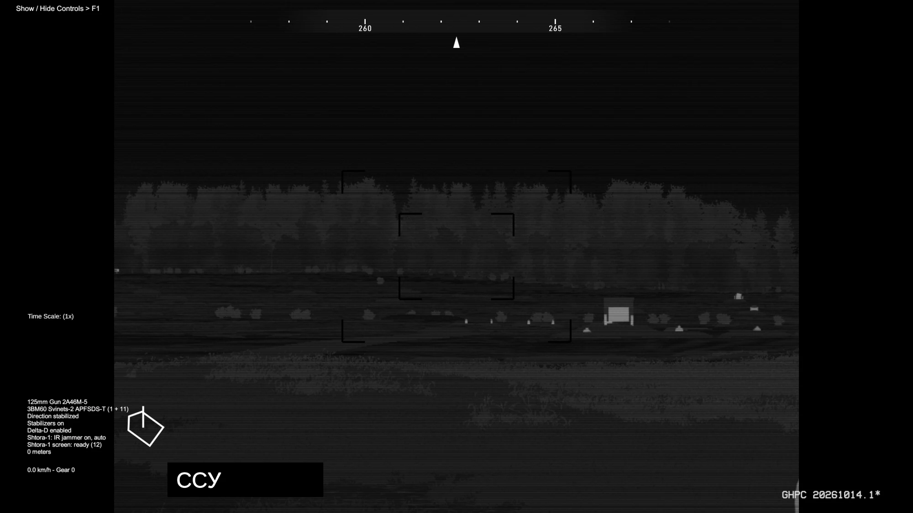
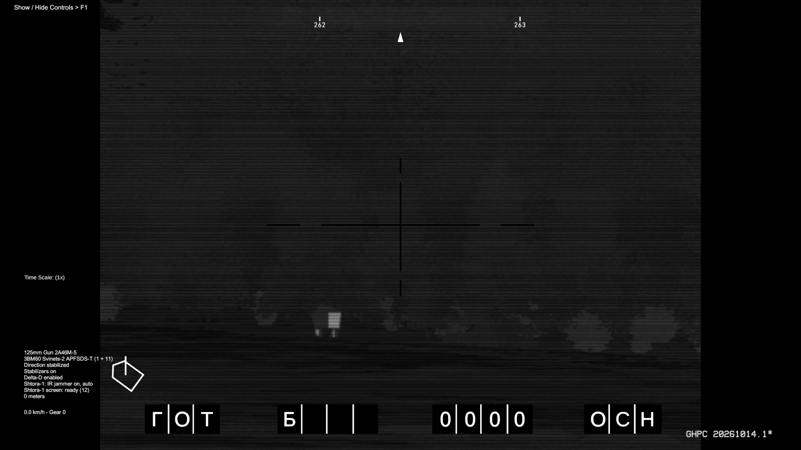
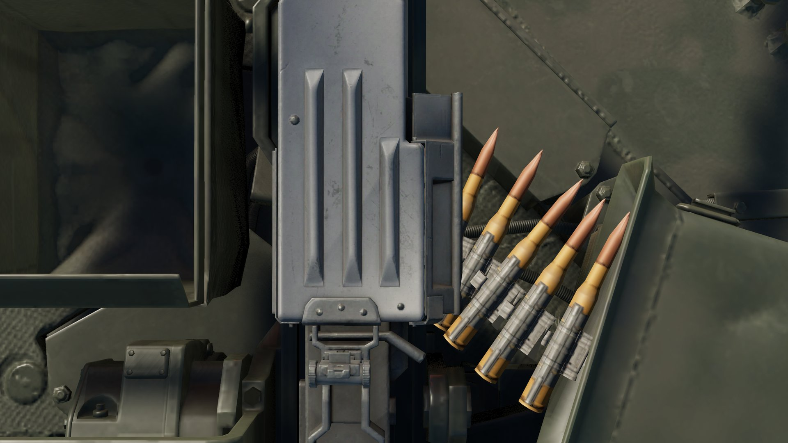
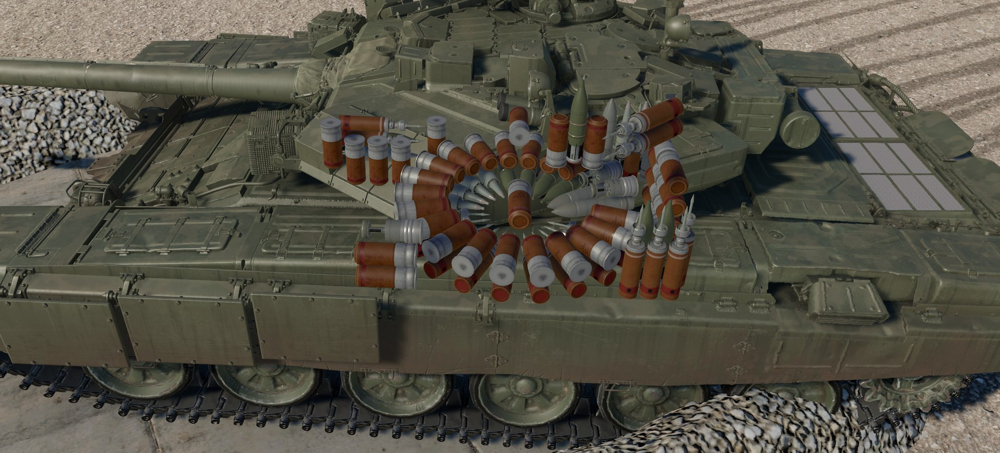
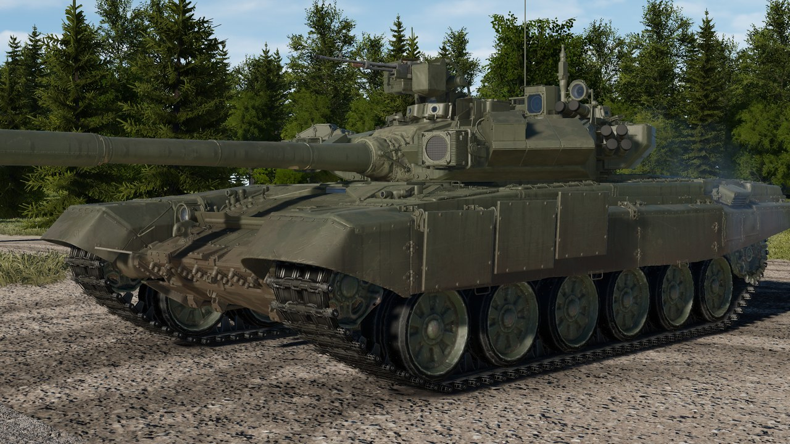
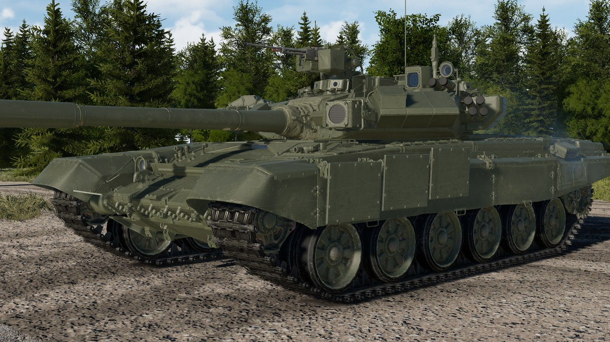

# The T-90A in detail

The bits that didn't fit in the [README](../README.md): the comparison with the T-72M1, the sights, the Kord and the
ammo up close, the numbers, and where the mod isn't quite the real tank. The armour and Shtora-1 have their own pages,
[armour.md](armour.md) and [screens.md](screens.md).

## From the T-72M1 to the T-90A

The T-90A (Object 188A1) is what the T-72B turned into, so underneath it's the same family as the game's own T-72M1.
Same hull layout, running gear, autoloader and gearbox. What changed:

| | T-72M1 (in the base game) | T-90A (this mod) |
|---|---|---|
| Turret | cast, quartz-filled cheeks | welded, 19 packages of reflecting plates in each cheek |
| Front armour without ERA, vs APFSDS (cheeks / glacis) | 471 / 452 | 690 / 549 |
| ERA | none | Kontakt-5, about +140 vs APFSDS / +550 vs HEAT |
| Gunner's sight | TPD-K1, TPN-1-49-23 image intensifier at night | 1G46 stabilised on its own, ESSA thermal, 1A45T fire control |
| Commander | head view, night vision goggles | TKN-4S day / night sight |
| Guided missile | none | 9M119M Invar through the gun, out to 5 km |
| Remote MG | none | Kord on the cupola, fired from under armour |
| Defensive aids | 12 smoke tubes | Shtora-1: IR jammer, laser warning, 12 tubes of 3D17 aerosol grenades |
| Engine | 800 hp | V-92S2, 1000 hp |

GHPC has no T-72B, so the T-90A is built on the T-72M1 (running gear, hull internals, autoloader, diesel) and takes its
army, voices, sight sounds and HUD from the T-80B. Those borrowed parts, plus the T-64B's machine-gun station and the
M60A3 TTS thermal screen effect, are copied once from the game's own files.

## A bit of history

Uralvagonzavod's design bureau started on Object 188 in 1986, basically a T-72B with the T-80U's fire control (the 1A45,
reworked for the T-72's autoloader as the 1A45T) and the new Shtora. It was accepted as the T-90 in October 1992, but
only about 120 were built for the Russian army before the money ran out. Export orders from India in 2001 kept the
factory going, and the Indian T-90S got a new welded turret. In 1999 the tank was named «Владимир» after its chief
designer Vladimir Potkin, who'd just died.

The T-90A (first called Object 188A1) brought all that home: the welded turret, the 1000 hp V-92S2, the 2A46M-5 gun, a
faster stabiliser and an autoloader reworked for the longer APFSDS rounds. It was accepted on 15 April 2005. The first
32 had the Buran-M image intensifier at night. From 2006 they got the ESSA thermal with the French Catherine FC camera,
and about 337 of those were built up to 2010. A lot of them have since been rebuilt into T-90Ms.

## The sights

  
  

*The ESSA's wide field, and the narrow field with the x2 zoom.*

**1G46:** 2.7-12x, stabilised independently of the gun, range and ammo readout under the picture. Line of sight -15° /
+20°, stabilised in both planes. The sight can run up to 8° ahead of the turret sideways, which is the real head's
travel, and the turret catches up. Its head is the low hooded box on the roof in front of the gunner's hatch.

**ESSA** (the default, as on most T-90As from 2006): the camera's 754 x 576 on a 4:3 CRT monitor, with scan lines and
black bars either side. 9 × 6.75° / 3 × 2.25°, electronic x2 zoom, up to 7.5° ahead of the turret. The narrow field has
the thin cross from the sight's manual and four black boxes under it: ready, round, range, mode. The wide field isn't
for firing, so no cross, just corner marks and a status box. I couldn't get hold of the manual's picture of that
field, so the marks are laid out like the T-90M's Sosna-U. The camera scans with a row of detectors and the picture
has faint streaks that drift about. How strong they are is set by eye. The mode box always reads "ОСН", because the
other fire-control modes aren't modelled.

**Buran-M** (2004, the image intensifier of the first 32 tanks) sits on its own stabilised head, -10° / +20°. The night
sight's head is the tall box behind the 1G46's.

**TKN-4S:** reticles drawn from a photo of the real one and the PNK-4S manual. Aiming chevron, lead marks, stadiametric
rangefinder, the Kord's ballistic scale and the ammo / ready indicator at the bottom. Its night field of view is a best
guess. The "Dubl" mode isn't built, so the commander can't fire the main gun from it, though its main-gun scales are
still drawn where they are on the real reticle.

## The Kord

- The belts are three B-32 armour-piercing incendiary to one BZT-44 tracer.
- **PZU-7** sight for semi-automatic mode, or the **TKN-4S** in "Avtomat" mode: stabilised, follows the sight, range
  keys set the superelevation. You only aim and fire it from those two, not from the commander's free-look head view.
- The spent cases go out of the chute on the right, forward like on the real 6P49. They lie on the tank until it tilts
  or brakes hard enough to shake them off.
- The cupola turns with it at up to 35°/s (45° left / 60° right of the gun), and the Kord elevates -5° / +70° at 24°/s.
  The 35°/s is the sight manual's figure; the 24°/s elevation is a guess.
- Drives, sight and barrel can be knocked out. The ammo belt flexes as the gun elevates.
- AI T-90As don't use it. Kept simple.

## The ammo

*Pressing O: the carousel's ring under the turret, the spares round it, the Invar missiles (grey-green) and the 3BM60s.*

- **22 in the autoloader's carousel** under the turret floor.
- **20 spares** in the T-72B manual's places: against the rear bulkhead, at the front right beside the driver, along
  the left wall and on the turret's rotating floor, each group in its own rack. The places are roughly where the T-72B's
  manual puts them. How they lie and the racks' shapes are a best guess.
- The 3BM60 has its own longer rod and sabot. The Invar is its own missile with the 9Kh949 charge instead of the game's
  Kobra, and each has the right stencils. They're made from the game's own round models, so they don't look out of
  place next to the vanilla shells.

## The paint

  
  

Weathered by default and made for the T-90A's own shape: dust and mud heavier toward the ground, grime in the crevices,
streaks down the sides, chipped edges and rust running from the bolts at the back. `Weathered paint` set to false gives
the clean factory finish on the right.

## Numbers

| | |
|---|---|
| Engine | V-92S2, 1000 hp at 2000 rpm, T-72 gearbox |
| Mass | 46.5 t |
| Speed | 60 km/h forward, 4.2 km/h reverse (the real gearbox's reverse) |
| Turret traverse / gun elevation | 24°/s / 28°/s |
| Gun | 2A46M-5, -6°13′ / +13°47′ over the front, less depression over the engine deck |
| Autoloader | The game's own T-72M1 timing, about 7.2 s for every round |
| Main gun ammo | 42 rounds: 3BM42 or 3BM60, 3BK29M, 3BK31 or 3BK18M HEAT, 3OF26 HE-Frag, 9M119M Invar |
| Coax PKT | 2000 rounds (8 belts of 250) |
| Smoke | 12 × 902B "Tucha", 3D17 aerosol grenades (each tube can be knocked out) |

| Round | Penetration |
|---|---|
| 3BM42 "Mango" | ~580 mm at the muzzle, ~460 mm at 2 km |
| 3BM60 "Svinets-2" (default) | ~690 mm at the muzzle, ~600 mm at 2 km |
| 9M119M "Invar" | 700 mm, tandem warhead (sets off ERA first), 100-5000 m, guided along the gunner's sight line |
| 3BK29M HEAT (default) | 700 mm (the maker's guaranteed figure), 915 m/s, 18.4 kg. The precursor only beats add-on ERA: a 2019 article by NII Stali people says it was never made to get through built-in ERA, so Kontakt-5 and Relikt count in full against it. 650 mm behind add-on ERA is my reading of a second, unlabelled figure in the same table |
| 3BK31 "Start-2" HEAT | 800 mm, 660 mm behind built-in and 680 mm behind add-on ERA, 19 kg. Experimental, never adopted, so the campaign never rolls it. Nobody publishes its muzzle velocity: I gave it 3BK18M's 905 m/s, because its direct-fire range is within 10 m of 3BK18M's |
| 3BK18M HEAT, 3OF26 HE-Frag | the game's own rounds (3BK18M under a name of the T-90A's own) |

## Where it isn't the real tank

- The armour you get by default is the game-scale set, matched to GHPC's other tanks: turret 690 / 820 and glacis 550 /
  750, without ERA. The open-source figures are lower (turret 575 / 750, glacis 500 / 650) and are the `source-only`
  setting.
- The plate shapes are War Thunder's. None of its armour ratings is used, but where no source gives a thickness (the
  turret's bottom plate, the driver's hatch, the nose beam) the plate is as thick as the model draws it.
- The gun's depression at each turret angle is my own table, with the barrel kept 1 cm off the hull all the way round.
  No source gives it. The gun's 28°/s elevation comes from a patent, not from a figure for this stabiliser.
- The cupola's 35°/s is the sight manual's figure for the hatch. The Kord's 24°/s elevation is my guess, and so is the
  mouth of its case chute. Its PZU-7 sight shows the T-64B's PZU-5 marks, because I found no picture of the real ones.
- Some sources give the T-90A the Agat-M commander's sight instead of the TKN-4S; I kept the TKN-4S. Its night field of
  view is a guess.
- The "Dubl" mode isn't built, so the commander can't fire the main gun from the TKN-4S, and AI T-90As don't use the
  Kord.
- The twenty spares sit roughly where the T-72B's manual puts them, because nothing gives the T-90A's own plan. How they
  lie in each place and the racks' shapes are a best guess.
- The ESSA's wide field is laid out like the T-90M's Sosna-U, because I couldn't get hold of the manual's picture of it,
  and its faint streaks are set by eye.
- The Shtora panel's lamp layout is inferred from the heads' sectors, and its mode knob is only drawn. Where the
  jammer's lock comes back after a jam, and how far its false commands wander, are my own numbers.
- The War Thunder model has no set-off ERA brick, so the blown-open look (off by default) is a best guess.
- The round mix (22 APFSDS, 8 HEAT, 8 HE-Frag and 4 Invar) and how the carousel's 22 split (12 / 4 / 4 and two Invars)
  are mine, because nobody publishes a standard load. Only the 42 rounds and the 22 in the carousel are sourced.
- In the campaign the 3BM60 only turns up after four missions, at a quarter of the 3BM42's rate, and less when
  logistics go badly. Those numbers are mine; nothing says how common it was.
- The darts' penetration at the muzzle is worked out so each meets the maker's figure at 2000 m (230 and 300 mm at 60°)
  in GHPC's model. The 3BM42 keeps the game's 3BM32 drag, because nothing gives its velocity loss. The 3BM60's flight
  mass isn't published, so it gets the 4.5 kg of its core from one Russian list, with the drag set for that list's
  3.5 % loss per 1000 m.
- GHPC flies a missile at one speed, so the Invar does 284 m/s all the way, which gets it to 5000 m in the real 17.6 s.
  It blows itself up 0.3 s later, my margin.
- The gun's -6°13′ / +13°47′ over the nose are the T-72A manual's. The only figure I found for the T-90A, one
  compilation's -7° / +20°, looks like the sights' limits.
- The autoloader keeps the game's T-72M1 timing, about 7.2 s a round. The T-90's own is 6.5 s at best, 8 s for the
  missile.
- The gearbox is the T-72A manual's, with the final drive worked out so each gear gives that manual's speed at 2000 rpm,
  and the reverse raised 8 % because the game's tracks run fast. The up-shift at 1900 rpm is mine: the game won't shift
  any later than that.
- The 1G46 zooms in nine steps from 20° to 4.5°. The real one zooms smoothly from 2.7 to 12x.
- The 1G46's and the ESSA's views sit where the T-72M1's sights are, on the gun, not in their heads on the roof. From
  the heads, at full traverse the view caught the head's own box now and then.
- The fire gate's 0.1° is the T-80B's 1A33 value, because the 1V528's isn't published.
- Nothing gives the Buran-M's field of view or look, so the T-80B's TPN-3-49 stands in. Where its head sat isn't known
  either, so its view is the T-72M1's night sight's.
- The TKN-4S's 7.8° day field is measured off the photo; Suvorov's table says 7°. The Kord's range keys stop at
  1600 m, where the manual's figure ends the scale I read as the Kord's.
- The jammer breaks guidance 6 times in 10 on every missile it works on. That's the published figure for MILAN and HOT.
  No source names the Shturm among them; I put it on the list with the other missiles guided from the launcher. The
  beam's 4.5° height I read as ±2.25°.
- The screens hold for 15 s after your own shot, the middle of the 12 to 18 s the sources give. An AI tank lases you
  again every 10 s while you're its target, and one blinded by a cloud judges range like the game's T-55 and T-62,
  give or take 10 %. Those are my settings.

**Sources**

These are the ones the numbers above and in the code lean on. The armour's own are on [armour.md](armour.md).

- Russian Wikipedia, [Т-90](https://ru.wikipedia.org/wiki/Т-90) (rounds, PKT belts, autoloader time, night sight
  limits), [Катрин-ФС](https://ru.wikipedia.org/wiki/Катрин-ФС), [Рефлекс (ПТРК)](https://ru.wikipedia.org/wiki/Рефлекс_(ПТРК))
  and [Корд (пулемёт)](https://ru.wikipedia.org/wiki/Корд_(пулемёт)).
- S. Suvorov, «Т-90. Первый серийный российский танк» (book): the V-92S2, 1G46 and TKN-4S tables, the Kord's Avtomat
  mode and its sector.
- btvt.narod.ru, [«Основной боевой танк Т-90А»](https://btvt.narod.ru/4/t-90a/t-90A.htm), and btvt.info,
  [«Основной боевой танк Т-90»](https://btvt.info/1inservice/t-90_v_strou.htm).
- vpk.name, [«Основной боевой танк Т-90 "Владимир"»](https://vpk.name/library/f/tank-t-90.html).
- [«Танк Т-72А. Техническое описание и инструкция по эксплуатации»](https://www.military-references.com/wp-content/uploads/books/tanks/ussr/t-72/%D0%A2%D0%B0%D0%BD%D0%BA_%D0%A2-72%D0%90_%D0%A2%D0%B5%D1%85%D0%BD%D0%B8%D1%87%D0%B5%D1%81%D0%BA%D0%BE%D0%B5_%D0%BE%D0%BF%D0%B8%D1%81%D0%B0%D0%BD%D0%B8%D0%B5_%D0%B8_%D0%B8%D0%BD%D1%81%D1%82%D1%80%D1%83%D0%BA%D1%86%D0%B8%D1%8F_%D0%BF%D0%BE_%D1%8D%D0%BA%D1%81%D0%BF%D0%BB%D1%83%D0%B0%D1%82%D0%B0%D1%86%D0%B8%D0%B8_%D0%9A%D0%BD%D0%B8%D0%B3%D0%B0_1_1986.pdf),
  book 1 (1986): the gearbox, the speeds, the gun's limits; and btvt.narod.ru's
  [«Основной боевой танк Т-72Б»](https://btvt.narod.ru/4/t-72B.htm) for where the spares go.
- Patent [RU 2421679](https://patents.google.com/patent/RU2421679C1/ru), the elevation drive.
- odetievbrony.ru's manual excerpts: [«Комплекс управления огнем 1А45»](https://odetievbrony.ru/viewtopic.php?id=457)
  (the laser, figure 9 the 1G46 reticle is measured off), [«Прицел 1Г46»](https://odetievbrony.ru/viewtopic.php?id=447),
  [«Прицельно-наблюдательный комплекс ПНК-4С»](https://odetievbrony.ru/viewtopic.php?id=460), the
  [ESSA's technical description](https://odetievbrony.ru/viewtopic.php?id=475) and
  [«Описание танка Т-90А»](https://odetievbrony.ru/viewtopic.php?id=347).
- Главком's blog, [«Технологии в танкостроении: СУО, прицелы»](http://glavcom.blogspot.com/2020/06/tehnologii-v-tankostroeniisuopriceli.html)
  and the NIMI brochure pages in
  [«Технологии в танкостроении. БПС»](https://glavcom.blogspot.com/2020/04/apfsdsbps3bm42mango3bm60svinec.html).
- [Interfax, 2019](https://www.interfax.ru/russia/666390) (Rostec on «Свинец-2»), btvt.info's
  [«Боекомплект танков Т-64/72/80/90. БОПС»](https://btvt.info/3attackdefensemobility/bps.htm) and
  [«Комплекс управляемого вооружения 9К119М «Рефлекс-М»»](https://btvt.info/3attackdefensemobility/tyr125.htm), and
  Rosoboronexport's [3УБК20 page](https://web.archive.org/web/20260831074331/http://roe.ru/production/land-forces/ammunition-sv/rounds/3ubk20/?theme=theme-green)
  on the Internet Archive.
- vimpel-v.com, [«12,7 мм пулемет "КОРД"»](https://vimpel-v.com/small_arms/kkp/4098-127-mm-pulemet-kord.html) (the belt,
  the case chute).
- btvt.info, [«Комплекс оптико-электронного подавления «Штора-1»»](https://btvt.info/3attackdefensemobility/koep.htm).
- In English: Thales' [Catherine-FC datasheet](https://pdfcoffee.com/catherine-fc-compact-thermal-imager-9-pdf-free.html)
  (a copy) and V. Fofanov's [«2A46M Autoloader: T-72 model»](http://fofanov.free.fr/Tanks/EQP/al-72.html).

## What it shares with my T-90M

I built the T-90A first, and the [T-90M](https://github.com/marsattackk/GHPC-T90M) after it on the same groundwork.
Everything I worked out here carries over: how the armour's put together, the ERA that doesn't go off for a PKT round,
the Invar's tandem precursor, the Kord's belt feed and spent cases, the paint, the T-80B's crew voices, and a fix on one
goes into the other. What's only on the T-90A is what's only on the real one: Kontakt-5, the 1G46 with the ESSA, the
TKN-4S, the Kord on the cupola and Shtora-1 with its IR jammer. It's still its own mod and neither needs the other.

My [T-80UM2](https://github.com/marsattackk/GHPC-T80UM2) came after both, on the same groundwork, and it's the T-90A's
closest relative of the lot: the same Kontakt-5, 1G46, TKN-4S and Invar, on the T-80U it was the rival of.
