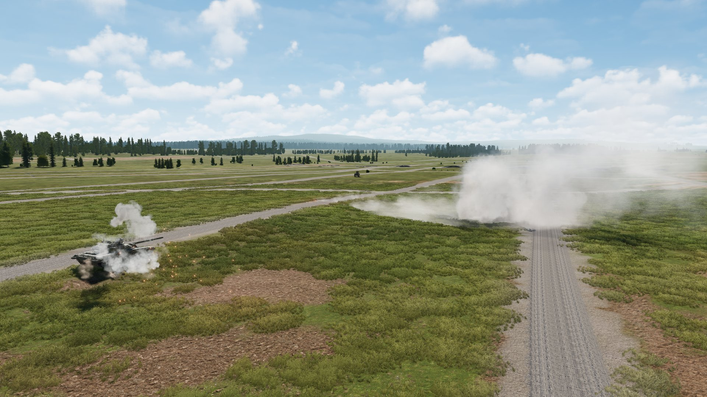
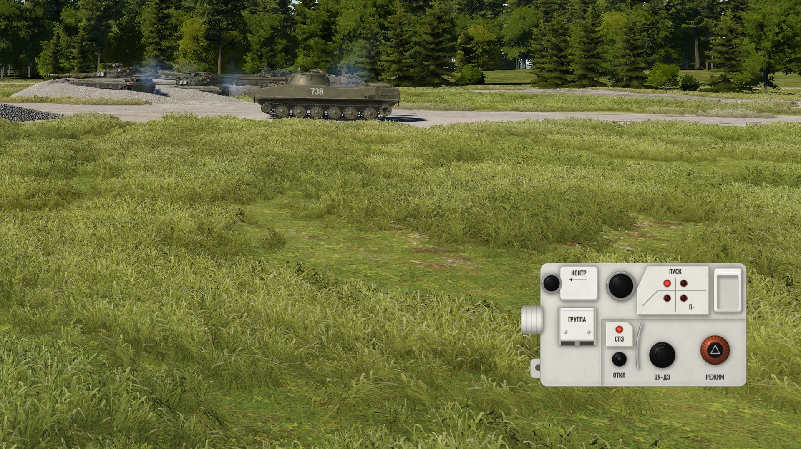

# Shtora-1

The T-90A's soft-kill system: an IR jammer, a laser warning and aerosol screens. What it does in a fight is in the
[README](../README.md#shtora-1). This is how each part works and what stops it.

  
  

## The jammer

The two red lamps either side of the gun (the TShU-1-7 emitters) are the jammer. A missile like a TOW has a flare on its
tail, and the launcher tracks that flare to steer the missile onto the sight line. The lamps flash modulated infrared
that looks like the flare, and as the missile flies away its own flare gets fainter while the lamps don't. Once the
lamps are brighter, the launcher locks onto them instead, steers with the wrong picture, and the missile goes off into
the dirt.

- It works on missiles guided that way: TOW, HOT, MILAN, and the Soviet Fagot, Konkurs, Kobra, Falanga and Shturm.
  Anything else it leaves alone.
- Only within ±20° of the gun sideways and a couple of degrees up and down, so point the gun at the threat. It's no
  force field either.
- Only on missiles actually fired at you by the other side. One aimed at the tank next to you, or one of your own
  side's, flies on as normal.
- It's on from the start. AI crews switch theirs on when they're fighting or getting shot at.
- Each lamp is a module and can be shot off. With one gone it works on that side only.

It breaks a missile's guidance 6 times in 10. That's the published figure for MILAN and HOT, and I've used the same
chance for the TOW and the Soviet missiles.

## The laser warning

Four heads on the turret watch for lasers, and they turn with it: two precise ones covering 45° either side of where the
turret points, two coarse ones for the rest of the circle. They see from 5° below to 25° above the turret's level. A
laser from higher than that isn't seen.

## The panel

The panel is the PU TShU-1M, drawn after a photo of the real one. It pops up bottom right with a warning tone, and its
four red lamps are the heads' sectors, all relative to the turret: top row front left / front right (up to 45° off the
turret's axis), bottom row rear left / rear right (the rest of that side). The real panel has its four lamps in a
square too, but no source I found says which lamp means what, so that layout is inferred from the heads. The mode knob
is drawing only.

Looking through a sight, the panel shrinks into the black strip under the picture. A new warning while the tone's still
going doesn't cut it off, and the lamps just follow the new one.

## The screens

From the front, in automatic mode, it fires a 3D17 grenade from the tube pointing closest to the laser. It goes out
50-80 m and bursts after a second. The cloud builds up in about 3 s and hangs for about 20 s. It blocks lasers and eyes
but not thermal sights, because the real one is made for visible light and near infrared.

From the side or rear you only get the warning, since a coarse head can't tell where to aim a screen. The vehicle menu
then has **Turn to Laser** for 20 s, which swings the turret round until a precise head sees it, and if they're still
lasing you the screen goes up from there.

## What it does to the shooter

An AI tank whose laser is blocked loses its rangefinder and judges the range by eye, give or take 10 %. Honestly
against APFSDS at 1600 m that barely matters, because the round's flat enough to hit anyway. It matters more for slower
rounds like HEAT, and the cloud hides you while it stands.

## When it won't fire

The screen won't go up when:

- a hatch is open
- you fired the main gun in the last 15 s (the real system holds the screens after your own shot, and 15 s is the middle
  of what the sources suggest)
- there's already a cloud on that line
- you're out of grenades or the tubes are knocked out. A destroyed tube's grenade can't be fired by anything until
  it's repaired.

## Using it

**Vehicle menu > Shtora-1** has Toggle IR Jammer, Aerosol Screen (fires one where the gun points, grenades left in
brackets), Screen Mode (AUTO, or SEMI where you get the warning and fire the screen yourself) and Turn to Laser after a
side or rear warning.

The weapon info bottom left gets a `Shtora-1:` line with the jammer (on, off, or "on, left only" / "on, right only"
once a lamp's gone) and the screen mode. Under it a `Shtora-1 screen:` line says "ready" with the grenades left, or why
it's held: hatch open, your own shot with the seconds left, no grenades. For a few seconds after a warning that brought
no screen it says why, which is either a laser from the side or a cloud already there.

The `Shtora-1` settings in the [README](../README.md#settings) switch off or tone down each part.
